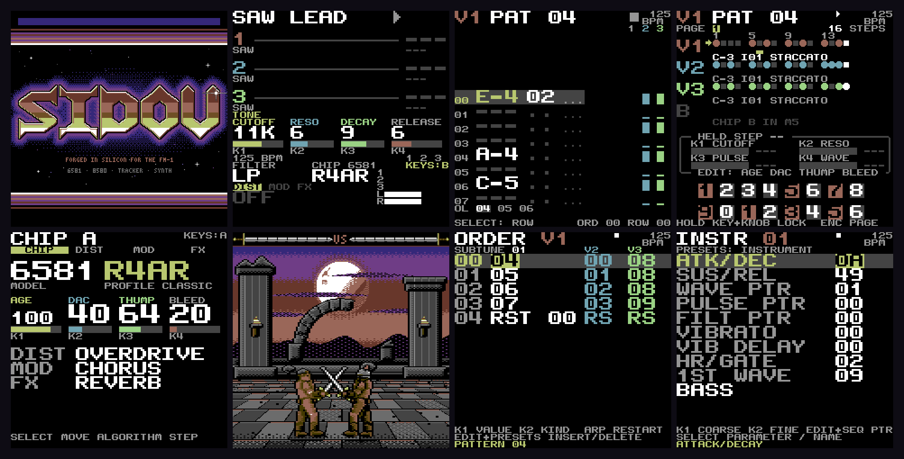
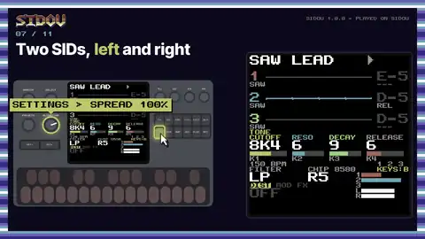

<!-- SPDX-FileCopyrightText: 2026 SIDOU contributors -->
<!-- SPDX-License-Identifier: GPL-3.0-or-later -->
<p align="center"></p>

# SIDOU

[](https://github.com/dsablic/sidou/actions/workflows/ci.yml)

SIDOU is free firmware that turns the M-VAVE FM-1 into a C64 SID music machine. It has two
SID chips, each with its own character: age, DAC sloppiness, thump and filter bleed. It
plays and saves GoatTracker 2 songs, so a song made on the panel opens in GoatTracker and a
GoatTracker song plays on the device. You write songs on the panel with STEP and a tracker,
and you can play the chip live from the keys or over MIDI.

<p align="center"></p>

*The boot title, LIVE, TRACKER, STEP, CHIP, the RED MOON RITE scene, ORDER and INSTR, from the
screenshots the tests check.*


[](https://dsablic.github.io/sidou/videos.html#sidou-intro)

**Watch:** [SIDOU in 79 seconds](https://dsablic.github.io/sidou/videos.html#sidou-intro) · [What's new](https://dsablic.github.io/sidou/videos.html#whats-new) · [all the how-to videos](https://dsablic.github.io/sidou/videos.html) · [the cheat sheet](https://dsablic.github.io/sidou/cheatsheet.html)

## What's new

Every release and what it brought is in [CHANGELOG.md](CHANGELOG.md), with each release's notes and
package on the [releases page](https://github.com/dsablic/sidou/releases); what comes next is in
[docs/ROADMAP.md](docs/ROADMAP.md).

## What you can do

- **Play the SID live.** Four presets (SAW LEAD, PWM BASS, SYNC LEAD, NOISE PERC) and DICE,
  which rolls a new sound at each turn. Cutoff, resonance, the sound's own control and the
  release are on K1 to K4.
- **Shape the chip.** The CHIP view picks the model (6581 or 8580) and a profile, and sets
  its character: age, DAC, thump and bleed. Three effect slots (distortion, modulation, FX)
  follow the chip in stereo.
- **Shape a sound and keep it (LAB, new in 1.0).** ENV, LFO and FX on LIVE open LAB: six
  pages (OSC, ENVELOPE, FILTER, MOD, FX, MACRO) draw what their four cards do, so you turn K1 to K4
  and see it: a filter LFO on FILTER, the arpeggio's rate on MOD, and on MACRO links that make the
  resonance follow the cutoff and the PWM follow the width. EDIT's tap compares A and B, holding
  EDIT while you play peeks at A, EDIT + LFO undoes (16 steps), EDIT + ARP varies a page and
  EDIT + SCL rolls the voice (neither is ever silent). One SAVE keeps the sound as one of 16 USER
  sounds, which PRESETS plays after DICE; EDIT + SAVE names it on the keys. A slot turned to OFF
  on the FX page bypasses the effect ([shape a sound in LAB](docs/manual/lab.md)). REC in LAB
  sends the sound to the song as a GoatTracker instrument while it plays, and ENV on INSTR pulls
  one back into LAB (new in 1.5).
- **Use two SIDs.** Songs play on one chip while the keys play the other, on top of the song.
- **Make songs on the panel.** STEP is a drum-machine view of a pattern, and a NEW song comes
  with a SID drum kit (kick, snare, hats, clap, toms, rim) and C64-style digi drums to put on
  its lanes. TRACKER is GoatTracker's layout, one voice at a time. ORDER, INSTR and TABLE edit
  the rest. REC records the keys and the filter knobs while the song plays, each note where you
  played it against what you heard, and parameter locks are on STEP, with a chance for each step;
  a held step sounds with its locks. TABLE's ARP helper writes arpeggios as wavetable rows, and the
  keys play the draft before you save it. MUTATE, DICE (density, range, scale, rhythm and a root
  for each lane) and a filter sweep write patterns in STEP and TRACKER.
- **Keep GoatTracker 2 songs.** SAVE writes a `.sng` to the device's flash. Power loss does not
  corrupt it.
- **Play `.sid` tunes.** SIDOU's own 6502 plays PSID tunes (one or two SIDs, PAL or NTSC) from
  the device's flash: the menu's SIDS lists them, NOW PLAYING shows the tune, its songs and its
  voices, with mute and solo, pause and stop, and MIDI start, stop and continue
  ([put a tune on the FM-1 and play it](docs/manual/sid-tunes.md)). Solo a voice and press REC
  to lift its next note as a GoatTracker instrument for your own song
  ([lift a sound](docs/manual/sid-tunes.md#5-lift-a-sound)).
- **Take a song into a DAW.** The site's [Songs to MIDI](https://dsablic.github.io/sidou/midi.html)
  page turns any GoatTracker 2 `.sng`, from a file or read straight from the connected FM-1 (the
  current song, or one stored on it), into a `.mid`, a MIDI channel a SID voice, with the notes where
  GoatTracker's player puts them, wavetable arpeggios included.
- **Play from MIDI.** Notes on every channel, CCs for the main controls, program change for
  presets and songs ([midi.md](docs/reference/midi.md)).
- **Record over USB.** The FM-1 is also a USB audio input, with no driver, on a computer or an
  iPad: a DAW records what the line out plays, in stereo at 44.1 or 48 kHz, over the same cable
  as USB-MIDI.
- **Look at it.** SCENE has generative pieces, and RED MOON RITE is the first illustrated piece.
- **Learn it from the device.** A first-run tour, and a help card on every screen.

Eleven openly licensed tunes for the store, a starter pack, are in [assets/starter](assets/starter),
and one `sidou-sysex sid --pack` command makes them a single upload
([the manual](docs/manual/sid-tunes.md#the-starter-pack)). STATUS shows how much of the CPU the
6502 takes.

## Try it in your browser

**<https://dsablic.github.io/sidou/>** runs the newest build in an emulated FM-1 (it follows the main branch, so it can be ahead of the latest release)
([fm1-emu](https://github.com/joakimeriksson/fm1-emu)). Play it from the computer keyboard,
the mouse, touch or a MIDI keyboard (Web MIDI). The emulated FM-1 keeps its flash in the
browser, so your settings and songs survive a reload. The page can export and import that
flash.

## Install

Installing is at your own risk, and SIDOU comes with no warranty; the official firmware is one
install away, and holding OCT- at power-on is a rescue ([docs/flash-day.md](docs/flash-day.md)).

1. Download the `sidou-<version>.fwsc` file from the [latest release](https://github.com/dsablic/sidou/releases/latest).
2. Install it with Felucca's installer (`fm1_install.py sidou-<version>.fwsc`). The unit then shows
   up on USB as "SIDOU FM-1", and later versions install over it the same way.
3. **Back to stock:** install M-VAVE's official `FM-1.fwsc` (V15) the same way.
4. **Recovery:** if the unit does not boot, hold OCT- alone while switching on, for about a
   second. That enters the chip's ROM boot mode, and the unbricker (`tools/fm1-unbrick-mac`, or
   MvaveFM1Unbricker) can restore a package. It needs nothing of SIDOU.

The installer has no backup, so save your songs first (see below). The
[hardware checklist](docs/hardware-test.md) says what has passed on a real unit and what has
not.

## Controls

On LIVE:

| Control | Does |
|---|---|
| Note keys | play the chip (F3 to G5 at the current octave) |
| OCT- / OCT+ | octave down and up |
| K1, K2 | cutoff, resonance |
| K3 | the sound's own control: pulse width, decay or sync ratio |
| K4 | release |
| PRESETS | the preset (DICE after the fourth) |
| SELECT / ALGORITHM | the knob page (TONE, DIST, MOD, FX) / the chip profile (the 6581s and the 8580) or the effect's algorithm |
| EDIT held + K1 to K4 | the selected effect slot's amount, A, B and mix |
| SCL | the next effect slot |
| ENV / LFO / FX | open LAB at its envelope, modulation or effects page |
| MASTER | volume |
| SEQ | the song views, back to the one you used last; again: STEP, TRACKER, ORDER, INSTR, TABLE |
| PLAY / REC | play and stop the song (with a `.sid` tune loaded, the tune; EDIT held pauses it) / record mode |
| SAVE | in the menu: opens the highlighted item; in a song view: saves the song |
| HOME | the menu from LIVE, back one view elsewhere (settings are under SETTINGS in the menu) |

**In LAB**: K1 to K4 are the page's four cards and ALGORITHM its choice; SELECT, or
ENV, LFO and FX, change the page; SAVE keeps the sound as a USER sound; tap EDIT for A/B, hold it
and play to peek at A; EDIT + LFO undoes, EDIT + ARP varies, EDIT + SCL rolls, EDIT + SAVE names;
REC sends the sound to the song (EDIT + REC over INSTR's instrument); HOME goes back to LIVE
([shape a sound in LAB](docs/manual/lab.md)).

**Hold HOME on any screen for its help card**: it says what each control does there, for what the screen is doing (SELECT turns a two-page card). Every control, every screen and every MIDI
message is in [docs/reference/controls.md](docs/reference/controls.md) and
[docs/reference/midi.md](docs/reference/midi.md).

## Songs and GoatTracker

SIDOU's songs are GoatTracker 2 `.sng` files ([format notes](docs/reference/song-format.md)).

- **On the device:** SAVE in a song view stores the song in the FM-1's flash. The menu's SONG
  item loads, creates, saves under a name and deletes songs.
- **Over USB:** SysEx GET reads a song from the device and PUT writes one to it
  ([protocol](docs/reference/sysex.md)); while a song plays, an upload waits for quiet so the
  music never dips.
- **The showcase songs:** a fresh install lists only the built-in SIDOU LOOP. The
  [Songs page](https://dsablic.github.io/sidou/songs.html) of the browser demo sends
  CHROME COMET, IRON RITE, NEON HIGHWAY and PAPER LANTERNS ([`assets/songs`](assets/songs/)) to a
  connected FM-1 in one click (Chrome or Edge: Web MIDI with SysEx; Safari has none). Run locally,
  `tools/web-demo` serves it at `http://localhost:8642/songs.html`.
- **On your computer:** the `.sng` opens in GoatTracker 2, and a GoatTracker 2 song put on the
  device plays there if it fits the device's limits. The device refuses one it cannot play, with
  a message.

## For developers

- [BUILDING.md](BUILDING.md): building the host tools, the firmware and the package.
- [TESTING.md](TESTING.md): the test layers, and what a failure means.
- [docs/videos.md](docs/videos.md): the how-to videos, made from the recipes in the emulator
  (`tools/make-videos`).
- [docs/decisions/](docs/decisions/): decision records, starting with
  [0001](docs/decisions/0001-test-and-benchmark-harness.md) (C on the device, Rust for host
  tooling) and [0002](docs/decisions/0002-m0-sid-cost.md) (M0 SID cost).
- [docs/hardware.md](docs/hardware.md) and [docs/hardware-test.md](docs/hardware-test.md):
  the FM-1, and the checklist for a real unit.
- [CONTRIBUTING.md](CONTRIBUTING.md): how to report bugs and send changes.

**In the emulator** (no hardware needed). Build the firmware and the package
([BUILDING.md](BUILDING.md)), then, from `host/`:

```sh
SIDOU_FM1_BUILD=$PWD/../build/fm1 cargo nextest run --release -p emu-gate
```

(`cargo install --locked cargo-nextest` once; plain `cargo test --release -p emu-gate` also works, more slowly.)

The tests boot the firmware and the package in fm1-emu, play the keys,
knobs and MIDI, and check the sound and the screen
([TESTING.md](TESTING.md)). `build/fm1/sidou_package.wav` is what the
package plays with the A4 key held from power-on. fm1-emu's own command
line runs the package too (`fm1-emu --fwsc build/fm1/sidou.fwsc --ms 10000`).

To run your working tree's firmware in the browser (Docker, Rust and Python 3 needed;
[BUILDING.md](BUILDING.md), "Browser demo"):

```sh
tools/web-demo          # builds everything, then serves http://localhost:8642/
```

## Status and roadmap

The releases and what each brought: [CHANGELOG.md](CHANGELOG.md). What comes next:
[docs/ROADMAP.md](docs/ROADMAP.md).

Installs, updates, the way back to stock, the OCT- recovery, MIDI and SysEx over USB, the song views, REC and `.sid` playback ([its flash day](docs/hardware-results/2026-10-25-m3-flash-day.md)) have run on a real unit; the first-run tour is still to be checked there. See the
[roadmap](docs/ROADMAP.md) and the
[design document](docs/plans/2026-10-14-sidou-design.md).

## Credits and licence

SIDOU stands on [Felucca](https://github.com/hugelton/Felucca) (the FM-1 platform code and
installer), reSID and reSIDfp (the SID models), [GoatTracker 2](https://sourceforge.net/projects/goattracker2/)
(the song format), and [fm1-emu](https://github.com/joakimeriksson/fm1-emu) (the emulator the
tests and the browser demo run on). The full list is in [CREDITS.md](CREDITS.md).

SIDOU is an independent community project. It is not affiliated with
M-VAVE or with Commodore trademark holders.

SIDOU is free software under the GNU General Public License v3.0 or later.
Third-party components keep their own licences. See [LICENSING.md](LICENSING.md)
and [CREDITS.md](CREDITS.md).
