<!-- SPDX-FileCopyrightText: 2026 SIDOU contributors -->
<!-- SPDX-License-Identifier: GPL-3.0-or-later -->
# SIDOU art direction

This page fixes the palette, font, layout grid, motion rules and logo before
screens multiply (design document, section 7 "Look and feel"). Every screen
and piece follows it. The visual reference is the browser prototype
(<https://claude.ai/artifact/Ghyhf6bUkXUFrawXbsc3X5>), which runs the same
grid, palette and font.

The look: an 80s home computer, C64 culture in spirit. Art is original only:
no Commodore marks, logos or trade dress, and no characters, sprites or names
from existing games.

Bitmap assets use the shared [row format](bitmap-codec.md); its reference covers the encoder,
the tile readers, checkpoints, RAM use and regeneration.

## Palette

Sixteen colours, the C64's, after Philip "Pepto" Timmermann's measurements of
the VIC-II. The firmware's table is `grid_palette` in `app/grid.c` (plain
RGB565). `ui_init` in `platform/fm1/ui.c` byte-swaps it once (`LCD_SWAP`), so
pixels the SPI sends from memory reach the panel high byte first.

| Index | Name (`GRID_…`) | sRGB | RGB565 |
|---|---|---|---|
| 0 | `BLACK` | `#000000` | `0x0000` |
| 1 | `WHITE` | `#FFFFFF` | `0xFFFF` |
| 2 | `RED` | `#68372B` | `0x69A5` |
| 3 | `CYAN` | `#70A4B2` | `0x7536` |
| 4 | `PURPLE` | `#6F3D86` | `0x69F0` |
| 5 | `GREEN` | `#588D43` | `0x5C68` |
| 6 | `BLUE` | `#352879` | `0x314F` |
| 7 | `YELLOW` | `#B8C76F` | `0xBE2D` |
| 8 | `ORANGE` | `#6F4F25` | `0x6A64` |
| 9 | `BROWN` | `#433900` | `0x41C0` |
| 10 | `LIGHT_RED` | `#9A6759` | `0x9B2B` |
| 11 | `DARK_GREY` | `#444444` | `0x4228` |
| 12 | `GREY` | `#6C6C6C` | `0x6B6D` |
| 13 | `LIGHT_GREEN` | `#9AD284` | `0x9E90` |
| 14 | `LIGHT_BLUE` | `#6C5EB5` | `0x6AF6` |
| 15 | `LIGHT_GREY` | `#959595` | `0x94B2` |

RGB565 keeps the top 5, 6 and 5 bits of red, green and blue.

Default use (the C64 theme, below; the boot's READY. screen is always this):
- **Screen:** light blue text on blue, inside a light blue border (the
  READY. screen).
- **Voices, by waveform** (in the C64 look of the boot and the scenes): pulse cyan, saw yellow,
  triangle light green, noise light grey.
- **Raster ramp** (logo stripes, raster bars): white, yellow, light green,
  cyan, light blue, purple, light red.
- **Warnings and errors:** light red; **OK:** light green.

## Theme

The 23 mm screen is read at arm's length while playing, so the views take their colours from
**roles**, defined once in `app/theme.c` (`app/theme.h`, a `theme` table in flash). A view never
names a colour of the 16 for a purpose of its own: it asks the theme for the role and builds its
cell attribute with `THEME_ATTR`. There are two themes, the menu's **THEME** item (persisted in
the settings record, schema 3: `live.theme`, so every view reaches it through its `live`):

- **HIGH CONTRAST**, the default: black, white values, light grey labels, dark grey for what is
  inactive, one accent colour per thing.
- **C64**: readable text on blue, with the menu's black-on-light-blue reverse-video bar
  and a blue-on-white toast. The popup keeps its old colours.

| Role (`theme.`) | HIGH CONTRAST | C64 | Used for |
|---|---|---|---|
| `bg` | black | blue | the screen |
| `value` | white | white | values, the focused text, the notes |
| `label` | light grey | cyan | names and labels |
| `hint` | light grey | cyan | legends, help lines, names under a choice |
| `dim` | dark grey | light blue | inactive things: a silent voice, a rest, an OFF slot, an unused control |
| `hot` | yellow | yellow | the focused tab, the current row's number, the popup's default accent |
| `alert` | light red | yellow | mute, REC, a refusal |
| `cursor` | dark grey | dark grey | the current row's background (TRACKER) |
| `voice[0..2]` | light red, cyan, light green | light grey, cyan, light green | voice 1, 2, 3: scopes, bars and large text |
| `voice_text[0..2]` | light grey, cyan, light green | white, cyan, light green | voice names at 1× |
| `knob[0..3]` | yellow, cyan, light green, light red | yellow, cyan, light green, light grey | K1-K4: bars, large text and the popup's accent |
| `knob_text[0..3]` | yellow, cyan, light green, light grey | yellow, cyan, light green, white | knob names at 1× |
| `title_*`, `menu_item`, `menu_value`, `sel_*` | light grey on black, white, cyan, yellow on dark grey | black on light blue, light grey, white, black on light blue | the menu |
| `toast_*` | black on yellow | blue on white | the toast |
| `popup_*` | the control's accent for the frame, name and bar fill, over a dark grey track | light blue frame, yellow name, light green bar | the value popup |

The accents are one per thing and the same everywhere: a knob's colour is its column on LIVE,
its column on CHIP and its popup's bar, so a turn is followed by colour without reading. A
role colour must read against its background: 1× text has at least 4.5:1 WCAG contrast,
large text and accents at least 3:1. The text roles separate small names from their accents:
light red on black passes for large text, not for 1× names. A host test measures both themes
from the panel's RGB565 palette, including cursor, menu, toast and popup pairs.
The theme change redraws every view at once (`screen_redraw`); the toast and the popup
read it as they draw (`screen_theme`).

## Layout grid

The 240×240 LCD is a grid of **30×30 cells of 8×8 pixels**, the same medium
as the C64's 40×25 PETSCII screen. Column 0 is the left edge and row 0 the
top; a cell is at pixel (8 × column, 8 × row).

- Each cell holds a font code and a colour byte: foreground in the low
  nibble, background in the high nibble (`GRID_ATTR(fg, bg)`).
- **Frames** take the outer ring (rows 0 and 29, columns 0 and 29). Content
  starts at column 2, leaving a one-cell margin inside the frame.
- **Title** on row 2; a status or toast line on row 26 or 27.
- Text is upper case. Lower case codes show as upper case.
- Pixel art beyond the font (oscilloscopes, the logo) is drawn as **pixel
  overlays** on cells: an 8×8 one-colour mask over the cell's glyph
  (`grid_overlay`, at most `GRID_OVERLAYS` = 255 cells at once, enough for
  LIVE's three scopes of about 80 cells each; the pool costs 2.5 KB of RAM).
  A view switch clears them all.
- **Large text** (`grid_text_big`) draws a string 2 or 3 times as large, from the same 8×8
  font and no new data: each character is 2×2 or 3×3 cells, its glyph pixel-doubled or
  tripled and cut into the cells, and each cell draws its own part. A cell holds a **piece
  code** instead of the glyph's (`GRID_BIG_FIRST` = `0x01`: `+ y * 2 + x` at 2×, `+ 4 + y * 3 +
  x` at 3×, `GRID_PIECE_PLAIN` = `0x0E` for a glyph at its own size that no overlay shows
  over, `grid_put_top`), and the grid keeps the character it is a piece of (`src`, 900 bytes
  of RAM). A piece is a blank glyph in the font, so a view that draws over its cells with
  ordinary text simply shows its own glyphs, and large text needs no clearing on a view
  switch; the renderer tests one cell code to tell a piece (about 2 instructions a cell,
  the pieces' own pixels cost about as much as an ordinary cell). 2× is 16-pixel characters
  (15 to a row), 3× 24-pixel (10 to a row); the font's 7×7 ink and one-pixel gap become 14
  and 2, 21 and 3. Used by the value popup, the toasts and the menu (below), and by LIVE, TRACKER,
  CHIP and STATUS for what is read while playing (their sections below); About keeps the
  8×8. A view that copies a canvas onto the grid cell by cell (CHIP, the song views) keeps the
  character of each piece in the canvas (`grid_canvas`, `grid_canvas_text_big`).

## Font

`assets/font/sidou-8x8.txt` is the source: one glyph per entry, 8 rows of
`#` and `.`, in a text format described at the top of the file.
`host/crates/sidou-tests` generates `app/font.c` (a `const` table of 256
glyphs, 2 KiB in flash) and `app/font.h` (`FONT_<NAME>` codes) from it; a test
fails when they fall behind the sheet. To change a glyph, edit the sheet and
run, from `host/`:

```sh
SIDOU_FONT_UPDATE=1 cargo test --release -p sidou-tests --test app font
```

The sheet draws 163 glyphs (lower case reuses upper case). The face is
chamfered capitals with 2-pixel stems, 7×7 pixels in the top-left of the
cell, so text keeps a one-pixel gap to the right and below.
Graphics glyphs fill the whole cell, so they join up. The firmware's glyph
sheet (the CHARSET view in `app/views.c`, opened from the menu) shows them
all, with the palette (the codes `0x01`-`0x0E`, large text's piece codes, blank glyphs, are drawn
as blanks); its fm1-emu snapshot is `tests/golden/lcd/charset.png`.

| Codes | Glyphs |
|---|---|
| `0x20`–`0x7E` | ASCII; `a`–`z` reuse `A`–`Z` |
| `0x7F` | `FULL` block (also the cursor) |
| `0x80`–`0x8F` | quadrants `Q0`–`Q15`; bit 0 top left, 1 top right, 2 bottom left, 3 bottom right |
| `0x90`–`0x98` | lower eighths `V0`–`V8`, filled from the bottom |
| `0x99`–`0xA1` | left eighths `H0`–`H8`, filled from the left |
| `0xA2`–`0xAA` | bar eighths `BAR0`–`BAR8`: left eighths on rows 1–6, for meters |
| `0xAB`–`0xBB` | ordered-dither levels `D0`–`D16` (4×4 Bayer, 4 × n pixels set) |
| `0xBC`–`0xCA` | frames: `BOX_H`, `BOX_V`, square and `ROUND_` corners, tees, `CROSS` |
| `0xCB`–`0xD8` | icons: dots, star, ball, pip, arrows, play, note, square |
| `0xD9`–`0xDB` | `SLOT_L`, `SLOT_R`, `SLOT_LR`: the logo's slotted raster bands, a top half's quadrants 3 rows deep |
| `0xDC` | `SCOPE_MID`: LIVE's dotted scope centre line, a pixel every 4 on the top row |
| `0x01`–`0x0E` | blank in the font, and the cell codes of large text's pieces (above) |
| `0x00`, `0x0F`–`0x1F`, `0xDD`–`0xFF` | blank, free for later glyphs |

**Provenance and licence.** The font is drawn for SIDOU. Its letters and
digits came from the browser prototype, and the rest of ASCII, the bar
eighths, tees and side arrows were drawn for the sheet in the same style.
The first version of the sheet was too close to `font8x8_basic`, the
public-domain placeholder of M1a: 14 printable glyphs were bit-identical to it
(`# $ & ( ) + . 1 > N W [ ] ^`) and 36 within 4 pixels by the measure below.
Every one of them that could differ was redrawn:
`! " # $ & ( ) + - / 0 1 4 < > @ K M N W [ \ ] ^ { }`.
The Commodore character ROM was not copied either: the face only takes the
C64's spirit (chunky capitals on an 8×8 cell).

`glyphs_are_not_copied_from_font8x8` in
`host/crates/sidou-tests/tests/app/font.rs` keeps it that way. It compares
each printable glyph with `font8x8_basic` (kept as test data in
`host/crates/sidou-tests/tests/data/`, never built into the firmware). The
distance is the number of differing pixels, the smallest over shifts of up
to one pixel in each direction. Every glyph must be at least 5 pixels away;
the median is 7. The exceptions are glyphs whose shape is forced at 8×8 with
2-pixel strokes. Any 8×8 font draws them nearly alike:

| Glyph | Distance | Why it stays close |
|---|---|---|
| `.` | 0 | A 2×2 dot on the baseline. |
| `,` | 0 | That dot with a one-step tail down to the left. |
| `'` | 0 | The comma's shape, raised to the cap line. |
| `_` | 0 | One full-width line on the bottom text row. |
| `` ` `` | 1 | A three-row tick down to the right. |
| `\|` | 2 | A 2-pixel vertical line; font8x8's is broken in the middle. |
| `:` | 4 | Two 2×2 dots. |
| `;` | 4 | The colon with the comma's tail. |
| `I` | 4 | A 2-pixel stem between full-width bars; the 4 pixels are font8x8's narrower bars. |
| `T` | 4 | A 2-pixel stem under a bar; the 4 pixels are font8x8's serifs. |

Licence: **GPL-3.0-or-later**, like the rest of SIDOU's own files, so the
font ships with the firmware under the same terms.

## Motion rules

- **25 fps:** the UI composes a frame every 40 ms (`UI_PERIOD_MS`).
- **Only changed cells go out.** The renderer (`app/grid.h`) keeps the frame
  the panel shows next to the one being composed. Changed cells are sent in
  runs: horizontally adjacent changed cells on a row form one LCD window.
- **SPI budget: at most about 20 ms of SPI per 40 ms frame at steady state.**
  At the LCD's 12 MHz SPI a cell is 128 bytes, 85 µs; a window adds 11
  command bytes (7 µs) and the CPU's command turnaround. 20 ms is about
  230 cells per frame. A full screen is 115,200 bytes, 77 ms.
- **CPU:** composing the status screen and the empty main-loop passes between
  frames cost about 37k instructions a frame, and rendering about 580
  instructions a cell, so a full screen is 2.2 ms of CPU at 240 MHz (fm1-emu,
  `host/crates/emu-gate/tests/screen.rs`).
- **Pieces over budget** drop their frame rate, shrink their area or use a
  coarser palette. A transition may spend a full redraw once, not every
  frame.
- **The main loop never waits on the LCD.** One run goes out per pass while
  the panel is free, rendered while the last one transfers. Nothing in the
  UI touches the audio interrupt or its budget.
- Each screen gets fm1-emu LCD snapshot tests; each animated piece gets a
  busiest-frame cost test (main-loop instructions and SPI bytes).

## Views, menus and transitions

The screen is a stack of **views** (`app/screen.h`): each is a table of
enter, exit, input and compose functions, and the one on top has the focus.
It composes every cell each frame and gets the panel's events first; what it
does not take plays the instrument (`app/views.h`,
[controls](../reference/controls.md)).

- **Frames:** PETSCII box glyphs with the title set into the top edge,
  between spaces (`widget_frame`). A screen keeps the full-block border on
  the outer ring (the main menu, drawn at 2× over the whole width, has none).
- **Menus:** a list of items, each a label and a value right-aligned against
  the edge (an arrow for an item that opens a view), SELECT moves the selection, ALGORITHM
  changes the value. The main menu (HOME) is drawn at **2× text** with six items of the
  sixteen showing: a title bar (MENU, an arrow up and down for the items out
  of sight, the item's number of the count; light grey on black in HIGH CONTRAST, reverse video in C64)
  in rows 0-2, a line of 14 characters every 3 rows
  from row 4 (a cell of margin each side: a panel's bezel hides its edge), the items white with
  their values cyan (C64: light grey labels and white values), and the selected item's whole line in a bar of its own
  (yellow on dark grey; C64 reverse video; no blinking block: a 2×2-cell block would send two
  windows a blink, and a bar reads better at a glance). Moving the bar and clearing its old
  row take priority; forced restorations then share the remaining quota with other rows.
  A coincident popup opening or refresh waits a frame for the bar, retaining its ask and
  lifetime. A refresh does not expand the box on the same frame. A line is up to 60 cells, so a scroll
  (every line changes) is drawn a line or two a frame, the selected line first, within 190
  cells less what a popup or a toast draws the same frame (`MENU_FRAME_CELLS`, `menu.budget`),
  with forced restorations marked by `menu.force_rows`; deferred rows follow within the quota. Labels
  are short so that value and label fit a line: **PRE** is PRESET (the longest preset name,
  NOISE PERC, is 10 characters), **ROWS** TRACKER ROWS, and STORE shows `193K` (kilobytes
  free), `FOREIGN`, `FORMAT?` or `ERASE 20`; the popup says the whole names. The help below
  (`SELECT  MOVE`, `ALG   CHANGE`: ALG is ALGORITHM) is large too. The menus of M2's views
  (and a CHIP-sized menu of the song's) can use the same widget at either size
  (`menu.scale`).
- **The MIDI page** uses the same 2× menu renderer: six of its ten items, a MIDI title bar
  with the selected item's number, a reverse-video selected line and help in the hint
  colour. It has no border, version, READY. prompt or blinking cursor.

  The main menu puts playing views first: CHIP, TRACKER, SCENE, SONG, then PRE, OCTAVE,
  KEYS, SOUNDS, ROWS, CARDS, STORE, THEME, STATUS, MIDI, CHARSET and ABOUT.
- **Toast:** reverse-video text (black on yellow; C64 blue on light blue) in **2× text** on rows 27-28 for 1.5 s,
  saying what changed: up to 13 characters; a longer one breaks at a space into two lines
  (rows 25-28, up to 26 characters), and one whose words fit neither (`SNG: A-4 PITCH NOT
  PLAYED`) shows at the font's own size on row 27.
- **Popup:** a change of a parameter from the panel (a K knob, ALGORITHM, MASTER) opens a box
  over the middle of the view, rows 10-18 and columns 1-28: a PETSCII frame on
  black, the parameter's name at **3× text** (24-pixel characters, up to 8; 2×, up to
  12, for a longer name), its value in white as large, and for a continuous value a bar of
  24 cells (eighths of a cell, `FONT_H0..8`, on dark grey); the frame, the name and the bar's fill
  are **the turned knob's colour** (K1 yellow, K2 cyan, K3 light green, K4 light red; yellow for
  the other controls; C64: a light blue frame, a yellow name, a light green bar). It opens 3 rows a frame (78
  cells), stays 1 s after the last change and closes 3 rows a frame, bottom first, the rows it
  lets go composed again by the view under it (the screen forces that). It is a screen layer
  like the toast, over any view: it covers its rows (`screen_cover`, so a view holding to a
  cell budget leaves them alone and sets aside what the popup draws), and guards them from the
  view's own large text (`grid_big_guard`). Its cells are plain pieces
  (`grid_put_top`): the overlays of LIVE's scopes under the box do not show, and the
  overlay changes under it send nothing (`grid_unstale`). It waits while a wipe or a raster
  runs, and a view switch takes it away at once. A change comes in as one byte the input path
  stores (`popup_ask`), and the frame asks the views for the text (`popup_text` in
  `app/views.c`, the one place that names and formats a control's value): MIDI changes do not
  ask (`VIEWS_POPUP_MIDI`).
- **Wipe:** a view opens top first and closes bottom first, 4 rows a frame
  behind a white edge row, so the full redraw a view switch needs spreads
  over 8 frames (about 320 ms). The rows not reached yet keep the old view
  on the panel.
- **Bands:** a cut spread over frames, for a view that comes in under a full-screen picture
  (the title cards, below): the view on top shows 6 rows a frame, top first, with no edge
  row (`SCREEN_BANDS`), 5 frames (200 ms), at most 180 cells, 15.4 ms of SPI, a frame.
- **Raster:** colour bands in the raster ramp's order run down the border,
  one row every other frame, then the border gets its own colour back. A chip
  change runs it once round the ramp (7 steps, 14 frames). It waits while a
  wipe runs.

Measured in fm1-emu (`screen_changes_and_transitions_stay_within_the_budgets`):

| Change | Frames | Windows | SPI bytes | Worst frame |
|---|---|---|---|---|
| Wipe up from the status screen to the menu | 8 | 52 | 78,908 | 11.6 ms |
| Wipe down from the menu to the status screen | 8 | 48 | 77,200 | 10.4 ms |
| Raster and toast (chip change) | 15, every other one | 451 | 123,105 | 10.5 ms |
| Menu idle (the selection: no blink) | none | 0 | 0 | 0 ms |

The animated screens compose every frame (`the_boot_and_about_stay_within_their_budgets`,
260 frames of the full boot and 1920 of About, a full round of its 16 pages), with Metal
Chrome:

| Screen | Cells a frame (average, most) | Windows a frame | SPI a frame (average, worst) | Main loop a frame (average, busiest `ui_poll`) |
|---|---|---|---|---|
| Full boot | 24, 150 | 8.1 | 2.1 ms, 12.8 ms | 37.3k, 33.5k instructions |
| About | 86, 163 | 15.9 | 7.5 ms, 14.0 ms | 117k, 71k instructions |

About costs 2.9M instructions a second (1.2 % of the core at 240 MHz). With Cracktro Chrome
it was 87 cells a frame, 118k and 72k, and the boot 37k and 33k. With Pulse Train
(M1e Task 4) it was 94 cells a frame (148 at most, 12.8 ms), 144k and 91k, and the boot
46k and 37k: the logo was animated, and the chrome logos are still. Metal Chrome's glow is
dithered, mostly runs of one and two pixels: with the decoder's loop over each run, a wipe
frame of its scene took the boot's busiest `ui_poll` to 41.4k; a run of one or two pixels is
now two stores, with no clamp while the longest run still fits (33.5k). A run's pixels are
written two at a 32-bit store, a cell row from two 4-entry tables (the glyph's colours, and
the overlay over the background for a blank glyph row): About was 161k and 105k, the boot
50k and 64k, with a pixel a store. A bitmap's run fills two pixels a store as well.

**Large text** (M2f) costs what it sends: the popup opens and closes 78 cells a frame, a value
change at most about 104 (the value's three rows and the bar), the menu a line or two (60
cells each) a frame, a scroll 3 to 6 frames; none of them more than 160 cells or 14 ms of
SPI a frame in fm1-emu (`the_popup_stays_within_its_budgets_over_every_view`,
`the_menu_stays_within_the_cell_and_spi_budgets_as_it_scrolls_and_under_a_popup` on the host):

| Popup over | Cells a frame (most) | Worst SPI | Busiest `ui_poll` | Static popup, extra a frame |
|---|---|---|---|---|
| LIVE, a note held | 132 | 11.3 ms | 30.7k | 7.3k (LIVE composes every frame) |
| STATUS | 132 | 11.3 ms | 33.7k | 0.15k |
| MENU | 132 | 11.3 ms | 36.5k | 0.15k |
| CHIP | 132 | 11.3 ms | 35.4k | 0.1k |
| SCENE (RULE 30, a note held) | 158 | 13.6 ms | 31.3k | 12.5k (SCENE composes every frame) |

A popup's frame that asks for it opens nothing (the view's own compose of a changed control
takes most of a frame: CHIP's detent is 35.7k in its busiest `ui_poll`, bound 38k); it
draws the rows it adds, and the text once its rows are in, and again only when the view
composed or the text changed. The input path stores two bytes and a pointer (the control and
the view it was made on: 13 instructions on a K1 turn, which is 218 on LIVE and STATUS, 234
on the menu and 230 on SCENE, bound 250; CHIP's 210, bound 215). The popup's state (names,
timer, the source) is not in the screen's struct but in the views', after everything else, so
that no field the input paths reach moved (the tightest input gates have a few
instructions to spare).

A wipe sends only the rows that differ, once each, and its edge row once
more; a raster step recolours the 116 border cells in 58 windows. Every frame
stays inside the 20 ms budget.

A wipe is sized for a view that holds still: the rows it has revealed must not change
under it. The animated views (About, the boot's title card) hold their animation while a
wipe or a raster runs (`screen_animating`), so a wipe into them sends its 150 cells a frame
at most, 12.8 ms. Revealing Metal Chrome's bitmap costs the main loop little more than cells:
the wipe into the title card (its whole scene, 4 rows a frame) 138k instructions a frame and
33k in its busiest `ui_poll`, into About 124k and 64k (Cracktro Chrome's: 134k and 30k,
118k and 65k). Before, About's bars, logo and
scroller moving in the revealed rows made
a frame of the wipe into it 243 cells, 21.0 ms, and the title card's stripes 192 cells,
16.6 ms (`every_wipe_into_an_animated_view_sends_only_its_rows` in fm1-emu, and
`the_wipe_into_about_sends_only_its_rows` and `the_wipe_into_the_title_card_sends_only_its_rows`
on the host, at every phase).

## UI sounds

SOUNDS in the menu (off by default, restored with the settings) plays short sounds on chip B's spare voice
(`app/ui_sound.h`): a cursor blip when the menu's cursor moves (a triangle C-6, two frames), a
confirm when ALGORITHM changes a value or opens a view (a pulse arpeggio E-5 G#5 B-5), a chime
with a toast (a triangle falling E-6 C-6 G-5), an error buzz for a refused action (the
cursor at the menu's end, an action turned counter-clockwise: a narrow pulse at C-2), and
SAVE's drive chunk (noise, then a low pulse, when an explicit save commits). They are
data in GoatTracker's sound-effect format (its readme, section 6.3), stepped at 50 Hz, so they
can be edited in GoatTracker and converted with INS2SND2. They are quiet and short by design:
the instrument is the thing to hear. They never take a voice the keys use: with the keys on
chip A they play on chip B, which is otherwise silent; with the keys on chip B (a song
playing) only on a voice that has finished its release, and a note that needs it takes it
back at once.

## Logo

**Metal Chrome, chosen by the user (replacing Cracktro Chrome)**, is SIDOU's logo: spiked,
blade-cut SIDOU letters (horn serifs, a sharp angled S, diamond counters in the D and O,
fangs on the U) with a chrome bevel running red, light red, orange, yellow and white, a black
outline and a 3-pixel purple extruded shadow, on a dithered purple and red glow (an airbrush
ellipse and a 13-pixel halo round the letters, in the 4 x 4 Bayer order), between warm raster
bars, with stars, a cross-flare glint on the U and the tagline "FORGED IN SILICON FOR THE
FM-1", on black, in the 16 colours only. It is original art made for SIDOU, drawn pixel by
pixel in code: the logo page's variant M1.

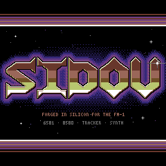

| Asset | What |
|---|---|
| `assets/logo/metal-chrome.js` | The source: the logo page's drawing code (variant M1), verbatim. `node assets/logo/metal-chrome.js` writes the PNGs below; they match Chromium's canvas drawing the page pixel for pixel. |
| `assets/logo/metal-chrome.png` | The scene, 240 x 240, 4 bits a pixel in the art palette's order: what the firmware shows. |
| `assets/logo/metal-chrome-lettering.png`, `-lettering-2x.png` | The lettering, its outline and its shadow alone, 226 x 63, on transparency (palette index 16); the 2x, by nearest neighbour, heads the project README. |
| `docs/art/avatar.png` | The avatar, 48 x 48: the S in its glow, between two stars. |
| `assets/logo/cracktro-chrome.js`, `cracktro-chrome*.png` | Cracktro Chrome (variant V2), exported the same way; its avatar is `cracktro-chrome-avatar.png`. |
| `app/logo_bitmap.c` | Both scenes as `grid_bitmap`s, generated (below). |

**Cracktro Chrome**, the logo until the user chose Metal Chrome and now an alternative:
chunky bevelled SIDOU letters in raster bands (white, light grey, cyan, light blue and blue
over brown, orange, light red and yellow), a black outline and a 4-pixel purple extruded
shadow, in a frozen demo-scene intro: stars, a cold and a warm raster bar and a perspective
grid floor.

The logo is a **pluggable asset** (`app/logo.h`): the boot's title card and About draw
whichever logo `logo_default` names, through a table in flash:

| Field | Metal Chrome (default) | Cracktro Chrome | Pulse Train |
|---|---|---|---|
| `cols`, `rows`: the footprint in cells | 30 x 9 (240 x 72 pixels, the scene's lettering band) | 30 x 8 (240 x 64) | 15 x 5 (120 x 40 pixels) |
| `overlays`: overlay cells at most | 0 | 0 | 55 |
| `cells_per_frame`: the most cells one frame changes | 0 (still) | 0 (still) | 42 |
| `draw(grid, col, row, frame, bg)` | the band in the pixel region | the band in the pixel region | frame `frame` of the animation (25 fps, 0 the still) |
| `scene(grid, frame)`: the title card's full screen | the whole scene in the pixel region | the whole scene in the pixel region | none (NULL) |

`draw` paints every cell of the footprint, glyph, colours, overlay and pixel region (it clears
an overlay it does not need), so a view composes it like the rest of its screen. The declared
cost and overlays are measured (`host/crates/sidou-tests/tests/app/logo.rs`), so a test fails
when a logo's drawing and its table disagree. `overlays` and `cells_per_frame` are 16-bit,
room for a logo up to the whole screen (900 cells).

Where it goes, and a test checks each logo fits (`each_logo_fits_each_consumers_slot`):
- **The title card** shows the logo's scene when it has one, with the version on row 1 and
  PRESS ANY KEY on row 28, both rows black in both chrome scenes (`BOOT_SCENE_VERSION_ROW`,
  `BOOT_SCENE_KEY_ROW`). A logo without a scene gets the old card: a slot 5 rows from row 8,
  between two ramp lines (`BOOT_LOGO_ROW`, `BOOT_LOGO_ROWS`), the name and the version below.
- **About** gives it 9 rows from row 0 (`ABOUT_LOGO_ROW`, `ABOUT_LOGO_ROWS`), centred:
  Metal Chrome's lettering band whole, Cracktro Chrome's on rows 0-7, Pulse Train on rows 2-6.

The emulator checks both against `assets/logo/metal-chrome.png` pixel for pixel: the
title card everywhere but its two text rows, and About's band against the scene's pixel
rows 80-151.

**The lettering band** is the scene's cell rows 10-18 (`LOGO_METAL_BAND_ROW`): the letters'
chrome takes pixel rows 83-141, their black outline and purple shadow 81-145, and nothing of
the letters' red, orange or yellow reaches outside the band; its stars and glow come with it.
The glow spreads beyond the band, so About shows it cut at the band's foot, against its
ramp line (the band's top is the screen's). The lettering is 65
pixel rows with its outline and shadow, one more than Cracktro Chrome's 64-row band holds:
About's band grew from 8 rows to 9, its first ramp line moved to row 9, and the stars between
the ramp lines lost a row; the credits keep theirs. Cracktro Chrome's band is its scene's cell
rows 9-16 (`LOGO_CHROME_BAND_ROW`).

**Pulse Train**, the other alternative (built), on the grid: the letters are a 5 x 7 face at 4x, so
each letter pixel is a cell quadrant. Their 28 pixel rows are seven bands of 3 rows and a
slot, coloured through the raster ramp. A cell row holds two bands: the top one as a `SLOT_*`
glyph in its colour, the bottom one as an overlay in the next band's. The pulse wave (2 pixels
thick, cyan) is an overlay on the two rows below. The stripes roll one band every 4 frames
(frames 2, 6, ...), the wave moves 4 pixels and its duty cycle sweeps every 4 frames (frames
0, 4, ...), and odd frames change nothing. `logo_default = &logo_pulse_train` brings it back
everywhere. Its letter cells use all three colours a cell holds, so raster bars cannot pass
behind them: tried with the letter cells taking the bar's colour as their background, the
bar's lower half took its upper half's colour in every letter cell, the letters' bottom bands
and the cyan wave vanished into bars of the same ramp colours, and About sent 110 cells a
frame instead of 95 (14.3 ms at worst).

The other concepts from the prototype, drawn in code on the cell grid, were Three Voices
(triangle, saw and pulse traces weaving through the letters), READY. (the name typed at the
prompt in quadrant blocks) and 28 Pin (SIDOU on a 28-pin chip whose pins light with the
gates). The logo page's other **metal variants** stay explorations: Blood Chrome (Metal
Chrome's letters in cold steel with a red underglow) and Metal Emblem (a chrome shield with
horns, bolts and the spiked lettering). Its **chapter cards**, full-screen title cards in the
Metal Chrome lettering, became the views' title cards ("Title cards", below).

### Logo bitmaps

A cell holds three colours at most (background, glyph, overlay), so a pixel-art logo in the
16 colours cannot be drawn with glyphs. It is supplied like the font and drawn through the
renderer's pixel region.

- **Source:** an indexed PNG in `assets/logo/`, at most 240 x 240 and in whole 8 x 8 cells,
  whose pixels are art palette colours exactly (its palette in any order); anything else is
  an error.
- **Conversion:** `host/crates/sidou-tests/src/logo.rs` (as `src/font.rs` is for the font)
  writes `app/logo_bitmap.c`, a `grid_bitmap` (`app/grid.h`) for each logo, using
  [run dictionaries and checkpointed row packets](bitmap-codec.md). Rows share packet
  substrings within a pool; any row or span decodes without another row or a buffer. A test fails
  when the file falls behind the PNGs (`SIDOU_LOGO_UPDATE=1` rewrites it, as
  `SIDOU_FONT_UPDATE` and `SIDOU_CREDITS_UPDATE` do), and others check the round trip and
  that the compiled table decodes to the PNG pixel for pixel.
- **Size:** Metal Chrome's whole scene is **9,730 bytes** of coded data and row offsets;
  Cracktro Chrome's is **3,971**, together **13,701**. The original byte-run encoding took
  9,753, 4,526 and 14,234 respectively; either logo raw at 4 bits a pixel is 28,800 bytes.
  The whole scene goes on the device, and About takes its band from the same bitmap.
- **Drawing:** `grid_region(g, col, row, w, h, bitmap, bx, by)` makes w x h cells take their
  background, pixel for pixel, from the bitmap's cells from (bx, by). Their glyphs'
  foreground and their overlays still draw over it, so text and overlays work on a picture
  (the title card's version and PRESS ANY KEY); a blank glyph shows the bitmap alone.
  `grid_render_run` decodes the run's part of each of its 8 pixel rows straight into the
  panel's pixels, two a store (a run of one or two pixels two plain stores), then draws the
  glyph and overlay pixels of the cells that have any. One region at a time: setting it marks the cells it leaves and covers to be sent, the
  same region again sends nothing, and a logo drawn in cells or a view switch clears it.

What works, and what does not, on this panel and budget:

- **A still logo, or a full-screen splash, works.** It goes out once, under a wipe (4 rows a
  frame, 12.8 ms of SPI at most), and costs nothing after that; the decoder runs only for the
  cells being sent. A full 240 x 240 repaint in one frame would be about 77 ms.
- **A 240 x 240 logo needs a title layout of its own.** The title card is the scene, with
  only two lines of text on rows the scene leaves black, and About takes the lettering band.
- **Palette cycling is not free.** The panel takes RGB565 pixels, not indexes into a palette
  it keeps: changing a colour means resending every cell that shows it. Rolling Cracktro
  Chrome's raster bands through the lettering would resend its 207 lettering cells in 22
  windows, 26.7 KB or 17.8 ms of SPI a step, on top of About's own frame (up to 163 cells):
  over the 20 ms budget. The stripes stay still; a roll would need a frame of its own every
  few frames, with About's other motion paused for it.
- **Small logos** of up to three colours a cell (a mono or two-tone mark) need no region:
  overlays carry them, one cell each, as Pulse Train's bands do.

## Boot

The boot sequence (`app/boot.h`) is a view over LIVE at power-on, after the
prototype's `Boot`:

| From | Shows |
|---|---|
| 0 s | `*** SIDOU V<version> ***`, the chip and voices, `READY.` and the cursor |
| 0.8 s | `LOAD"SIDOU",8,1` typed, 70 ms a character |
| 2.2 s | `SEARCHING FOR SIDOU` |
| 3.0 s | `LOADING`, and raster stripes in the border, new every other frame |
| 5.6 s | `READY.`, then `RUN` typed from 6.2 s |
| 7.0 s | the title card: the logo's scene (Metal Chrome's), the version and licence above it, `PRESS ANY KEY` blinking below |
| 10.0 s | LIVE wipes in |

The stripes split each border cell row in two colours at a random height (a lower-eighths
glyph): the 116 border cells, about 10 ms of SPI, every other frame. Every other change goes
out within the budget; the first frame is drawn whole before the display is on.

- **Full once per firmware version:** when the stored version is missing or differs from
  the installed version, the full sequence plays and the current version is saved with the
  settings. Later boots of that version show the title card alone, 1.2 s, then LIVE.
  Reinstalling the same version does not reset this choice. Let the settings save finish
  before powering off: its background write is debounced for 5 s and waits for quiet. A
  foreign store cannot remember the version until explicitly formatted, so it keeps showing
  the full sequence. **HOME held while powering on** always plays the full sequence: once the interrupts
  are on, `platform/fm1/main.c` waits `FM1_DEB_PRESS + 1` key scan frames (3.3 ms; the audio
  already runs) and reads HOME's debounced level. The key scan also makes one press edge for
  a key held at power-on; the boot takes that first HOME press as part of the hold. Without
  HOME held, a HOME press skips like any other button, from the first frame on.
- **Skippable by anything:** a button or an encoder ends it at the next frame and does nothing
  else (the boot's capture takes it: no octave step, no chip toggle); a note from the keys or
  MIDI ends it and plays, even one shorter than a frame (`live`'s note-on count tells).
  What MIDI changes meanwhile (the chip, the octave) shows no toast or raster over it.
- **It holds nothing up:** the audio interrupt, the tick (the key scan, MIDI) and the
  interrupts start before the screen's first frame, and the main loop sends that frame like
  any other, without waiting on the panel (a full screen, about 80 ms of SPI on the device);
  the display comes on once it is out. The keys and MIDI play from the start: in fm1-emu the
  audio starts 394 ms after power-on, after `lcd_init`'s 350 ms of reset and wake-up delays
  (`the_audio_and_the_keys_start_before_the_display`). Before, the first frame went out
  whole, blocking, before the audio started.

## About

ABOUT, the menu's last item (`app/about.h`), is the prototype's cracktro trimmed to the SPI
budget, on black, laid out around Metal Chrome's lettering band: the logo at the top
(rows 0-8), a ramp line (row 9), the credits over a starfield (heading on row 10, lines from
row 12), another ramp line, and two raster bars sweeping behind a sine scroller (rows 21-29).
The bars are Cracktro Chrome's cold and warm ones (blue, light blue, cyan; brown, orange,
light red), with no white, and the scroller is white, so its letters read over every band.
HOME goes back.

- **Credits** come from `CREDITS.md`: `host/crates/sidou-tests/src/credits.rs` generates
  `app/credits.c` (a page per section, more when it runs over 8 lines, wrapped at 26
  characters with names kept whole, accents dropped for the font). A credit longer than a
  page starts a page and goes on under `<SECTION> (CONT.)`, cut between who and what; no
  other credit shares a page with its tail, so no sentence runs into the next credit. A test fails when it falls behind the file;
  `SIDOU_CREDITS_UPDATE=1` rewrites it. A page shows 4.8 s; a first page names SIDOU, its
  version and licence.
- **The trim**, from the prototype's 240 cells a frame to 87: the logo is still, sent once
  under the wipe; the bars are 5 bands of 4 pixels (two a cell, with a lower-half glyph) and
  move one band at a time, one bar on each odd frame; the credits' rows cascade in and out 4
  frames apart,
  fading through 4 colours a level every other frame, so at most two text rows change in a
  frame; the scroller's letters are overlays shifted 2 pixels a frame, each bobbing a whole cell
  row on a sine two screens long; the stars are one-pixel overlays in three layers moving a
  pixel every 4, 2 or 1 frames, on blank cells only. Measured above (Motion rules).

**Naming:** the instrument is **SIDOU**, always in capitals, in the font or
the logo's own letters. "SID" refers to the chip only when describing what
SIDOU emulates.

## LIVE

LIVE (`app/live_view.h`) is the root view, what the screen shows from power-on, drawn after the
screen-readability prototype's `liveNew` for a 23 mm screen: large text for what is read while
playing, one colour per voice and per knob, black behind it
([the theme](#theme)). Each part is placed on the cell grid, at 2× text where it is read:

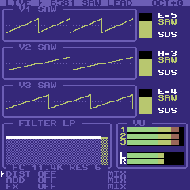
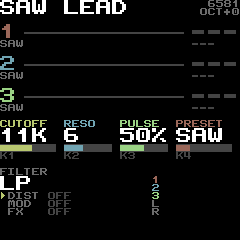
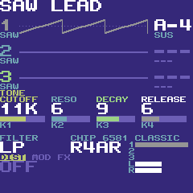

- **Rows 0-1:** the preset's name at 2× (white) and, when the octave is not 0, the octave at 2×
  in yellow on the right (`+1`, `-3`; nothing at 0). While the song's voices are muted or soloed
  (GLO), the name's place says which in red at 2× (**M13 S2**: voices 1 and 3 muted, voice 2
  soloed).
- **Rows 2-13, three voice lanes of 4 rows:** the voice's number at 2× in its colour (grey while
  the song mutes it) with the waveform's name small under it (SAW, PUL, TRI, NOI, MIX); its
  oscilloscope from column 3, 160 × 32 pixels, **drawn 2 pixels thick** in the voice's colour
  (light red, cyan, light green) over a dotted centre line, and **dark grey and flat while the
  voice is silent** (its envelope at nothing); the note at 2× on the right (white while its key
  is held, dark grey once let go) with the envelope's stage small under it (ATK, DEC, SUS,
  REL).
- **Rows 14-19, the knob row:** what K1..K4 turn on LIVE, in their left-to-right order, four
  columns of 8, 7, 7 and 8 cells, under the page's name in yellow on row 14 (`TONE`; the selected
  slot's, `DIST`, while EDIT is held or SELECT has paged to it): CUTOFF, RESO, K3's control and
  RELEASE small in the knob's readable colour (yellow, cyan, light green, light red), each value
  at 2× in white under it **in at most 3 characters** (the cutoff as `980`, `7K2` or `12K`, the
  resonance `0..15`, K3's by the sound: `RATIO` the sync ratio's semitones `-12`..`+12`, `PULSE` the
  pulse width as one side's percent `50%`, `DECAY` `0..15`; the release `0..15`), a bar in the knob's colour on a dark grey
  track, and the knob's name K1..K4 small in the legend colour. **A knob that just turned has its
  label in reverse video for a second**: no popup opens over LIVE for the knobs. EDIT held turns
  the selected slot's four controls, and the row says so: the page tag is the slot's and the
  labels its controls' names (`DRIVE`, `TONE`, `BIAS`, `MIX`), dim where the algorithm has no use
  for them.
- **Rows 21-26, the bottom band:** FILTER's label, **CHIP 6581** (the model) and **KEYS:B** in
  yellow on the right while the keys play chip B; the **mode at 2×** (LP, BP, LP+BP, HP, NOTCH,
  BP+HP, ALL, or OFF in dark grey) and the chip's **profile at 2×** (`R4AR`, `WORN`, `USR3`, in
  reverse video for a second after ALGORITHM changes it); the three **effect slots' names**
  (DIST, MOD, FX; OFF ones in dark grey, the one the panel edits in reverse video) with the
  selected slot's **algorithm at 2×** under them (`OVERDRIVE`, OFF in dark grey; in reverse video
  in yellow while the knob row shows the slot, and for a second after ALGORITHM changes it);
  and **VU**, a bar for each voice in its colour and the output's left and right peaks after the
  effect slots in white, 6 dB a cell, its labels in the legend colour.

**What moved or went.** LIVE had more on it than the 23 mm screen can show at a readable size.
Each item below moved to the place that shows it better, or is gone:

| Was on LIVE | Now |
|---|---|
| a header line in reverse video: `LIVE` and the play mark, `KEYS:B`, the chip, the preset, the octave | the preset at 2× on rows 0-1, the chip and octave small on the right; `KEYS:B` in the bottom band; the title `LIVE` is gone (the screen is the root view) |
| each voice in a box with its title `V1 SAW`, its envelope as two columns of lower eighths (ENV3), its pulse width `PW50` | the number and waveform's name in the lane; the **envelope bar is dropped** (the scope's height is the waveform times the envelope, and the stage stays under the note); **the per-voice pulse width is dropped** (K3's PULSE is the setting) |
| FILTER, the response of the mode at the cutoff and resonance in 16 columns, and ` FC 11.4K RES 6 ` | the **response curve is dropped** (no room at a readable size, and nothing else shows the filter's shape); the mode is at 2×, the cutoff and the resonance are the knob row's first two columns (the popup still says the cutoff as `11.4K`) |
| VU in a box | the same meters in the bottom band, no box |
| the three slots, `DIST OVERDRIVE MIX` and their mix as a bar | the algorithm of each slot stays; **each slot's Mix bar moves to the CHIP view** (and the popup says it when EDIT + K4 turns it) |
| the preset, in the header only | the header only; PRESETS (the big encoder) turns it, and K4 became the release |

**The tap.** The audio interrupt renders a block in chunks of 16 samples and after each
writes a point into a ring of 256 (`app/scope.h`): each voice's waveform output (its top 8
bits) and its oscillator's phase (the accumulator's top 8 bits). Once a block it copies each
voice's ENV3, envelope state and sustain level, and raises the left and right peaks with
every 8th frame of the output. Rendering in chunks gives the samples one call gives, so the
audio is unchanged (the device's output matches the host's sample for sample with LIVE
showing). It runs only while LIVE shows: on top, or under MIDI learn's frame. Single producer, single consumer, lock-free: the
interrupt overwrites the oldest points and publishes its head once a block; the main loop
copies the newest 224 and drops the copy if the interrupt came round to it meanwhile.

| Tap | Measured (fm1-emu, `the_live_view_tap_costs_the_audio_interrupt_little`) |
|---|---|
| Points | 2,757 a second (a frame: 110; a read: 224, 81 ms) |
| Audio interrupt | +4.44 instructions a sample (406.71 against 402.27, a chord held, LIVE against the menu, since M1b Task 6's 6581 filter and the points from inside one render a block, `sid_render_tap`; 4.8 at M1e), bounded at 4.5 (`TAP_PER_SAMPLE`, which the effect gates count) |
| Code in `.ram_text` | 32,472 of 49,152 bytes (+308: `scope_render`, `scope_peaks` and their calls) |
| RAM | the ring and envelopes 1,560 bytes; LIVE's state 6,116 (its traces and their columns, the points it reads, its canvas) |

**The scopes are folded by phase** (an equivalent-time display): each point lands in the
column its oscillator's phase belongs to, two to four periods across (more for higher
notes), a column showing the mean of its points and the empty ones a line between their
neighbours. A held note's trace stands still at any pitch, and 110 points a frame draw it
whole where a time base would need 20 times as many. A hard-synced voice is folded by its
sync source's phase, so the sync shape shows. The height is the waveform times the envelope:
flat at rest. A trace that moved by a pixel at most stays as drawn (the fold's wobble), so a
held chord sends about 5 cells a frame. The trace is two pixels thick (a pixel more under
each column's span): the cells it crosses are the same four rows by twenty, so the budget
below holds, but more of them have ink, and a voice's colour (its own while it sounds, dark
grey flat once its envelope is nothing) changes in place (`grid_overlay_color`: the cells of its
last trace are recoloured, only the cells whose shape changed are drawn again).

**The budget.** Each trace is an overlay per cell it crosses (at most 240 of the pool's 255).
Three voices of noise change about 240 cells a frame, 20.5 ms of SPI: over the budget. LIVE
holds itself to 200 cells a frame (`LIVE_VIEW_FRAME_CELLS`, about 17.5 ms with the windows):
the scopes get what the rest of the frame and the screen's toast and raster leave
(`screen_layer_cells`), and a trace that does not fit keeps its last look and goes first next
frame, so the voices take turns. The canvas (the small text and the bars) is composed off the
grid, built whole once and then a part at a time: the header, a voice's lane, the knob row and
the bottom band are drawn again only when what they show changes, a meter only its own cells,
and a toast's frames put back only the toast's rows. The large text is drawn on the grid
itself (`grid_text_big`) for the rows that were copied, so a part that did not change draws
none. Going back to the menu
leaves the traces flat and the meters empty, so LIVE comes back at rest rather
than showing what it showed when it went. The tap is
read half way between frames (`views_prepare`), so no main-loop pass is long enough to hold
up MIDI (the M1d latency gate). While a wipe or a raster runs LIVE holds still, redrawing the
overlays a view switch cleared one voice a frame, ahead of the wipe.

Measured in fm1-emu (`live_stays_within_its_budgets`; the redesign's numbers, with the numbers
before it in brackets):

| LIVE | Cells a frame (average, most) | Windows a frame | SPI a frame (average, worst) | Main loop a frame (average, busiest `ui_poll`) |
|---|---|---|---|---|
| At rest | 0, 0 | 0 | 0, 0 | 13.2k (13.8k), 3.7k (4.3k) instructions |
| A chord of saws, from the note-ons (75 frames) | 4.5 (4.4), 154 (158) | 1.3 (1.5) | 0.4 ms, 13.4 ms (13.8 ms) | 46.8k (47.2k), 60.5k (59.3k) |
| Three voices of noise (75 frames) | 155.9 (146.2), 172 (160) | 26.6 (24.0) | 13.5 ms (12.6 ms), 14.9 ms (13.9 ms) | 154.5k (147.9k), 63.4k (60.7k) |

The thick trace costs the noise case 4.5 % more instructions a frame (the bound is 155k: 0.5k
to spare) and 10 more cells a frame: every voice's four rows by twenty are inked in noise
whatever the thickness, and a voice that fits the budget is 80 cells.

## CHIP

CHIP (`app/chip_view.h`, from the menu behind THE CHIP's card) is a chip's sound a section at a
time, chip A or chip B, drawn after the screen-readability prototype's `chipNew` on the theme's
colours ([the theme](#theme)): black, the section's choice and its four controls at 3× in the
knobs' places.

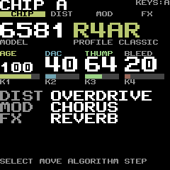
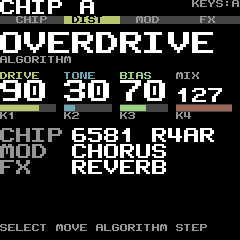
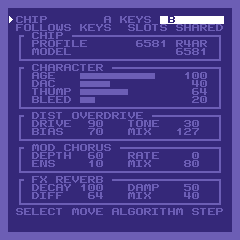

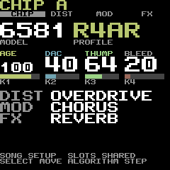

- **Rows 0-1:** the title **CHIP A** or **CHIP B** at 2× (white; yellow while the focus is on the A/B
  tabs, which is how the A/B tab shows its focus), and on the right, small, **KEYS:A** or
  **KEYS:B** on the tab of the chip the keys play (where the old `KEYS` beside the tab
  letter stood).
- **Row 2:** the section tabs **CHIP, DIST, MOD, FX** across the width, the focused one yellow
  with the background's colour for its letters, the others in the label colour on the screen's
  background; with the focus on the A/B tabs the CHIP tab is reversed in the label colour
  (its controls are what K1..K4 turn there). SELECT moves the focus as
  the A/B tabs, CHIP, DIST, MOD, FX, then EXPERT, clamped at both ends.
- **Rows 4-6, 7:** the section's main choice at 3×: for CHIP the chip's model (`6581`, white) and
  its profile (`R4AR`, yellow: the name without the model, `WORN`, or **USR 3** for a picked
  USER slot), over the small names MODEL and PROFILE in the hint colour; for a slot its algorithm
  (white, OFF dark grey) over ALGORITHM in the hint colour. **With a save target** (EDIT +
  ALGORITHM on the chip) the names row reads **SAVE TO USER 3** (and ` -` while that slot is
  empty) in yellow: the old CHIP frame's
  title had no room, and here it sits under the profile it will store.
- **Rows 9-14, the four controls in the knobs' places** (the same columns as LIVE's knob row):
  the label small in the knob's text colour (`knob_text[k]`: yellow, cyan, light green, light
  grey in HIGH CONTRAST; K4 white in C64): AGE, DAC, THUMP, BLEED, or the slot's names for what
  Amount, A, B and Mix do in its algorithm; the value 0..127 at 3× in white, a bar in the knob's
  accent colour (`knob[k]`) on dark grey, and the
  knob's name K1..K4 small in the neutral, readable hint colour.
  **A value of 100 or more is drawn at 2× instead** (on the lower two rows of its three): three
  digits at 3× are 9 cells and a column is 7 or 8, so it cannot be 3× at 100..127 without
  running into the next column. A control the algorithm does not use and every control of a
  slot that is off have dark grey labels, values and bars, with their generic names (AMT, A,
  B, MIX); the K1..K4 tags keep the hint colour.
- **Rows 16-21, the other sections** at 2×, a line each (the name in grey, its state in white): on
  the chip, DIST, MOD and FX with their algorithms; on a slot, the chip's model and profile
  (`6581 R4AR`) and the other two slots.
- **Rows 27-28:** the tab's note (nothing on chip A with no song; on the B tab FOLLOWS KEYS  SLOTS
  SHARED, or SLOTS SHARED WITH CHIP A while the keys play chip B; on a song's A tab SONG SETUP
  SLOTS SHARED) and the help line, SELECT MOVE ALGORITHM STEP, small in the hint colour. The toast keeps
  rows 27-28 while it shows.

**EXPERT keeps the readable design.** It is one final SELECT stop, not another menu. The
ordinary four-section strip and the chip/slot layouts stay unchanged; on EXPERT the strip
becomes one yellow EXPERT marker and the 3× choice says **EXPERT 1/4** through **EXPERT 4/4**.
ALGORITHM pages four direct controls at a time, rather than selecting a scrolling item and
repurposing K1/K2 as coarse/fine. This keeps all four physical knobs useful and bounds every
control's reach to at most three page detents, with no menu diving.

The long units need more width than CHIP's seven-cell columns. EXPERT therefore uses two
pairs: K1/K2 at columns 0/15, names on rows 9-10 and values from row 12; K3/K4 on rows 17-18
and from row 20. Names are at 2× in the knob's accent colour (`knob[k]`), preceded by a small
K1..K4 tag in the neutral hint colour; values include their units at 3× up to four characters,
otherwise 2×. Even `20000HZ` fits its
half-screen without clipping. The last page's unused lower pair stays blank. Every turn's
popup uses the same named parameter and unit formatter, retaining the theme's popup colours.
Inactive names and values are dim, with **N/A** for the value; their knob tags remain readable.
The summary lines give way to this second pair; row 25 says **MACRO MOVES RESET ITS
OVERRIDES** in the hint colour, while the chip/song note and help remain at the foot. The help becomes SELECT
MOVE ALGORITHM PAGE. EDIT + ALGORITHM retains the USER save target here too, in the same
yellow names row; SAVE includes the independent expert settings.

**Where the old page's pieces went.** The three effect slots' four controls each, at 8×8 on
one page, are now a slot at a time (a SELECT to see them; they were never what K1..K4 turned
with the chip in focus). The CHARACTER frame is the CHIP section's controls; the PROFILE and
MODEL rows are the choice at 3×; the play mark in the margin and the white frames are the yellow
tab; the frames' own titles (DIST OVERDRIVE...) are the choice at 3× and the lines at 2×.

**The budget.** The page is built in a canvas off the grid whenever what it shows changes (a byte
each for the profile, the model, the character, every slot field, the selected slot, the focus and
the theme), and its changed cells are copied onto the grid within 200 cells a frame
(`CHIP_VIEW_FRAME_CELLS`) less what the toast, the raster and a cover take, as SCENE copies its
canvas: a frame that changes more spreads over the next ones. The canvas holds the characters
the large text's pieces are pieces of (`grid_canvas`), so a changed digit costs the cells of that
digit. The cells MIDI learn's frame or a toast covers are left alone, and the border while the
raster runs. Idle it compares its bytes and composes nothing. Measured in fm1-emu
(`chip_stays_within_its_budgets`):

| CHIP | Cells a frame (average, most) | Worst SPI | Main loop a frame (average, busiest `ui_poll`) |
|---|---|---|---|
| Idle | 0, 0 | 0 | 6.8k, 6.6k instructions |
| A knob's detent (25 frames) | 0.2, 5 | 0.45 ms | 8.0k, 29.9k |
| A tab switch (25 frames) | 1.4, 36 | 3.1 ms | 8.2k, 29.0k |
| The busiest: every control over MIDI at once, a focus move and a chip change (50 frames) | 24.7, 200 | 17.58 ms | 38.7k, 27.6k |

Before the redesign (the numbers the bounds were set from): idle 6.8k, a detent 8.1k with a busiest
`ui_poll` of 35.9k, a tab switch 8.4k, the busiest 39.0k. The new page builds a bigger canvas
(more text, large pieces), so its build and its scan of 900 cells were made cheaper to pay for
it (rows written by pointer, the blank by `memset`, the scan one flat comparison a cell), and
the busiest `ui_poll` fell by 6k. At the page's character a step to the 8580 and the others cost
what they did (the profile change is the chip reset, decision record 0006, "Cost").

RAM: the view's state 2,780 bytes (1,880 before), most of it the canvas (cells, colours and the
characters of the large text's pieces: 2,700 bytes).

## SONG

SONG uses the song views' shared canvas, not a second screen-sized buffer. The
title is at row 2, the 2× LOAD/NEW/SAVE AS/DELETE choices at rows 6, 10, 14 and 18,
with reverse video marking the selection.
LOAD and DELETE list eight filenames per page; scanning advances one directory
entry per frame. Filenames remain 1× so all 16 characters fit. SAVE AS splits its
large 16-character name into two eight-character lines at rows 8 and 12, with the
cursor underneath and a SAVE action at row 16. Confirmations use large text and
default to reverse-video NO. Help is at the
bottom, with HOME consistently returning to the preceding page.

Both themes use the shared colour roles: title foreground/background for the
heading, menu-item and selection colours for actions and filenames, value for
the edited name, hot for its cursor and busy status, alert for destructive
questions, and label for help. Changing THEME rebuilds the open page without
leaving it.

Only changed cells are copied, at most 200 per frame including overlays. The
reference images are `song`, `song-load`, `song-save-as` and `song-confirm`.
TRACKER shows SAVING in place of its pattern heading while a file is being
written. During a streamed load it retains the previous canvas; the completed
load invalidates cached rows before showing the new song.

## STEP

STEP (`app/step_view.h`, the first song view: SEQ from anywhere) is the song made like a drum
machine, in TRACKER's readable style and the theme's roles ([the theme](#theme)): **the 16
leftmost note keys are 16 steps** of the selected voice's pattern, and a **held step plus a
knob is a parameter lock** ([controls](../reference/controls.md#step)).

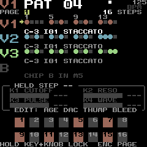
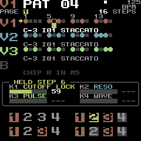
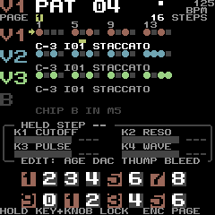
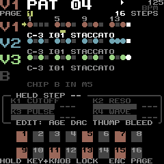

- **Rows 0-1, the header:** as TRACKER's: **V1** at 2× in the voice's colour, its pattern
  **PAT 04** at 2×, MUT or SOL, the play mark, the tempo and REC.
- **Row 2:** `PAGE` and the page numbers (the shown page reversed yellow) and the pattern's length
  (`64 STEPS`); **row 3** the ruler: the number of each group's first step (`1 5 9 13`).
- **Rows 4-15, four lanes of three rows:** V1, V2 and V3 at 2× in their colours, and **B**
  greyed (`CHIP B IN M5`). The selected lane has the arrow. A lane's 16 steps are in columns
  5-23 in groups of four: **a dark square for an empty step, a ball in the voice's colour for a
  note, the playing step white**, and under it the notch row: a **yellow** notch is a LOCK, a
  **cyan** one a SET (a step with both shows the yellow one); the held step is a yellow block.
  The line under each lane says its note, its instrument and its gate (`C-3 I01 STACCATO`).
- **Rows 17-22, the HELD STEP frame:** `HELD STEP 6` (and the step's note), then the four knobs
  as `K1 CUTOFF`, `K2 RESO`, `K3 PULSE` and `K4 WAVE`, each with a bar in the knob's colour and
  its value (a percentage for the cutoff and the pulse width, 0-15 the resonance, `TRI`,
  `SAW`, `PUL` or `NOI` the waveform), `LOCK` in yellow on a locked one and `SET` in cyan on the
  waveform command. They are grey until a step is held. The last line says what EDIT turns the
  knobs into: `EDIT: AGE DAC THUMP BLEED`.
- **Rows 24-28, the pads:** the 16 keys as two rows of eight, a step with a note in the lane's
  colour, the held one yellow, the others dark grey; steps past the pattern's end are blank.
  **Row 29:** `HOLD KEY+KNOB LOCK  ENC PAGE`.

The value popup names what a knob on a held step sets, in the knob's colour: `CUTOFF`,
`RESONANCE`, `PULSE WIDTH`, `WAVEFORM` (`OFF`, `TRI`, `SAW`, `PULSE`, `NOISE`), the character's
four, `PAGE` (`2/4`), `NOTE` and `INSTRUMENT`.

**The budget.** The view builds into the song views' shared canvas in three zones, each only
when its own look changes: the header with the pages and the ruler (rows 0-3), the lanes
(rows 4-15: the playing step moves, the edits and the locks) and the frame and pads
(rows 16-29: only the edits, the locks, the held step and the page do). While a wipe shows the
view a zone is built when its rows are reached, so the SEQ pass is not the whole canvas at once
(68.4k instructions built whole, 49.6k this way). The copy sends the changed cells top first
within 200 cells a frame (`song_view_copy`). Idle it composes nothing. Measured in fm1-emu
(`the_step_view_stays_within_its_budgets`):

| STEP | Cells a frame (most) | Worst SPI | Main loop a frame | Busiest `ui_poll` |
|---|---|---|---|---|
| Idle (25 frames) | 0 (0) | 0 | 7.2k | 1.7k |
| A lock turned on a held step (K1, 25 frames) | 14.5 (132) | 11.3 ms | 18.1k | 35.2k |
| A step tapped | 1.9 (47) | 4.1 ms | 11.3k | 34.9k |
| ALGORITHM, a page turn | 13.9 (132) | 11.3 ms | 15.1k | 30.8k |
| Playing SIDOU LOOP, 100 frames, from PLAY | 5.5 (133) | 11.4 ms | 16.3k | 45.7k |
| SIDOU LOOP, 30 s | 2.1 (16) | 1.45 ms | 14.6k | 36.8k |
| A dense song at tempo 3, 30 s | 4.4 (16) | 1.45 ms | 22.3k | 36.4k |

The inputs and the busiest pass after each (bounded at 3.9k and 61k, inside the poll allowance
with a register-ring slice): SEQ from LIVE 3.5k / 49.6k, PLAY 2.0k / 34.6k, a step key (the note
keys' pass) 39.9k, K1, K2, K3 locks 1.4k, 1.3k, 1.3k / 39.2k, 44.8k, 32.7k, K4 SET 2.5k / 49.7k,
PRESETS' note 3.2k / 54.4k, ALGORITHM 0.5k / 31.1k, ARP 0.2k / 20.2k. No frame was cut short in
the 30 s runs. RAM: the view's state is 96 bytes of the RAM region (its look, a four-action
queue and the lanes' notes), and its code and strings about 9.6 KB of the image.

## TRACKER

TRACKER (`app/tracker_view.h`, from SEQ or the menu) is the song's patterns in GoatTracker 2's
layout, drawn after the screen-readability prototype's `trkNew`: **one voice at a time at 2×**,
12 rows visible, the other two voices as activity strips ([the theme](#theme)).

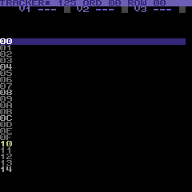
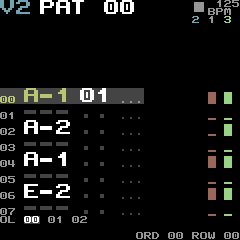
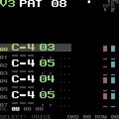
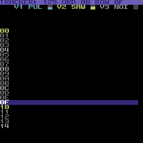
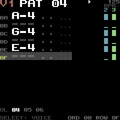
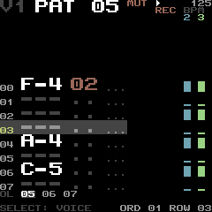

- **Rows 0-1, the header:** the shown voice **V1** at 2× in its colour (light red, cyan, light
  green; grey while the song mutes it), its pattern **PAT 03** (hex) at 2× in white, **MUT** in
  red or **SOL** in white small beside it, and on the right a play mark or a stop square, the
  tempo in BPM small (with BPM under it) and **REC** in red.
- **Row 2:** the other two voices' numbers, over their strips, in their colours.
- **Rows 3-26, 12 pattern rows** of two cell rows: the row's number small at the left (hex; yellow
  on the current row, grey otherwise), the note at 2× (`C-4`, white; `---` a rest in dark grey,
  `===` a key off and `+++` a key on in grey; yellow on the current row), the instrument at 2× in
  the voice's colour (`..` none, dark grey) and the command small (`308`: the command and its
  data, grey; `...` none, dark grey). **The current row is a dark grey bar** across columns 0-17,
  the rests and blanks on it in grey so that they stay visible. Muted rows keep their colours;
  the header and strips show the mute. Each row's cells are the voice's own pattern's, from its orderlist entry.
- **Columns 26 and 28, the other two voices as strips:** a bar a row, bottom-aligned in the row's 16
  pixels, **tall (12 px) where a note sounds on that row of that voice's own pattern, short (2 px)
  where none does**, in the voice's colour; nothing past the end of its pattern; dark grey and short
  while the song mutes it. They show that the other voices play, and where.
- **Rows 27-29:** OL and the shown voice's orderlist from its entry (the entry in white on the bar's
  grey, the two after it in grey: a pattern in hex, `R2` a repeat, `+3` or `-1` a transpose, `RST00`
  the end and its restart position); the current row's first command, of the voices that sound,
  spelled out in yellow (`V2 4 22 VIBRATO`); the hint `SELECT: ROW` in dark grey and, on the right,
  `ORD 03 ROW 1A` in hex (the position the old header said).

**The cursor.** The cursor is a voice and a row. **SELECT steps rows** (EDIT held: an 8-row page),
**ALGORITHM steps the shown voice**, 1, 2, 3 and round, either way
([controls](../reference/controls.md#song-views)). With REC off the row is the song's while it
plays, the stopped cursor's otherwise. REC keeps the edit cursor on screen while playback
continues. The row number is a yellow block and the edited field is black on yellow at 2×;
command/data expands to 2× while selected. K1–K4 use the large value popup, in the knob's colour;
refusals and TIDYING use large toasts. The note keys audition on the shown voice.
The row drawing (`draw_row`, `draw_window_row`) takes the voice, the row, whether it is
the cursor's and a field to highlight (`TRACKER_VIEW_FIELD_NOTE`, `_INSTRUMENT`, `_COMMAND`: the
field's cells on yellow), which an edit cursor reuses as it is; the strips and the footer are
separate (`draw_strip`, `build_footer`).

Each voice shows the pattern of its orderlist entry: while the song plays the entry and row
of its last row event, stopped the cursor's. **The moving bar** (TRACKER ROWS BAR, the
default): the rows stand still and the bar moves down the 8-row page with 4 rows of context
above; at the page's end the window moves a page. **Scrolling** (TRACKER ROWS SCROLL,
GoatTracker's): the bar stays on window row 5 (screen rows 13-14) and the rows move under it.

**The budget.** The header and the footer are built into the song views' shared canvas when
they change (the tempo, REC, a mute, the voice), the rows when the window, a pattern or a mute
does; **a step of the bar alone redraws only its two rows and the footer** (`build_step`: a test
checks the canvas against a whole build at every row of a page, with every voice shown and a
voice muted), and only the rows built are compared with the grid, their changed cells going out
top first within 200 cells a frame (`SONG_VIEW_FRAME_CELLS`) less what the screen's layers take.
The bar's grey covers 18 columns, not the row: a step repaints two bars, so the width is what it
costs (25 columns made the step 100 cells and the playing frame 36k instructions against its 28k
bound). The canvas holds the characters of the large text's pieces (`grid_canvas`). Measured in
fm1-emu over 30 s of each (`the_tracker_stays_within_its_budgets_while_a_song_plays`):

| 30 s playing | Cells a frame (average, most) | SPI a frame (average, worst) | Main loop a frame (average, busiest `ui_poll`) | Frames at the cap |
|---|---|---|---|---|
| SIDOU LOOP (tempo 6), bar | 30.4 (25.6), 161 (129) | 2.62 (2.22), 14.07 ms (11.35) | 27.7k (27.5k), 23.9k (31.3k) | 0 of 750 (0) |
| SIDOU LOOP, scroll | 59.9 (83.5), 177 (200) | 5.29 (7.31), 15.56 ms (17.56) | 59.8k (51.1k), 22.8k (33.9k) | 0 of 750 (257) |
| A dense song at tempo 3 (a note on every row of every voice), bar | 56.5 (61.7), 173 (200) | 4.87 (5.36), 15.09 ms (17.79) | 46.5k (49.7k), 24.2k (38.1k) | 0 of 750 (38) |
| The same, scroll | 41.0 (100.6), 174 (200) | 3.65 (9.08), 15.29 ms (17.58) | 64.9k (90.0k), 21.2k (36.6k) | 0 of 750 (24) |

(In brackets, before the redesign.) The bar's step is two bars and the footer (30 to 70 cells); a
page turn (about 300 cells) spreads over two or three frames, the first six window rows built and
copied, then the rest. The scroll changes every row whose text differs from the one above it,
and 12 rows of 18 columns is fewer cells than 25 of 29: it keeps up at tempo 6 and at tempo 3,
where the old layout lagged (the rows ran up to a frame or two behind the music, never the
sound). The busiest `ui_poll` fell from 31-38k to 21-24k, because the build is split over the
frames and a page's cells are copied by a loop of their own (`song_view_copy`). Idle and stopped
it composes nothing (the song views' table in `tests/screen.rs`: 8.0k instructions a frame idle,
8.3k with REC, 9.6k a mute: against 8.1k, 8.3k and 9.8k before).

RAM: the song views' state 2,824 bytes (1,920 before), most of it their shared canvas (with the
characters of the large text's pieces). The two canvases and the characters they keep are
1,788 bytes of the views' 17,280; free RAM went from 14,544 to 12,752 bytes (the gate keeps 9,000). At the end of M2d the RAM region and POOL together have 8,520 bytes free (4,256 and 4,264; the gate keeps 7,000, each region 4,096) and the image is 493,840 bytes ([the plan](../plans/2026-10-15-m2d-step-tracker.md#status-m2d-complete-tasks-1-7-2026-10-22)).

### TRACKER, edited and recording

With REC on, the edited field is reverse yellow at 2x, the row number a yellow block, and a
command or its data expands to 2x ([controls](../reference/controls.md#editing-tracker)); K1-K4
use the large value popup. The edits cost nothing while idle (the same row-and-footer redraw as
a cursor step). Measured in fm1-emu by `tracker_edits_from_the_panel_are_readable_and_bounded`
(M2d Task 3, the numbers as the plan records them after its rebase onto `c1831e9`, not re-measured since; the input is the instructions of the panel event, the pass the busiest main-loop
pass after it; the bounds, unchanged, are 4,600 and 55,000):

| Edit | Input | Busiest pass | While the song plays (input / pass) |
|---|---:|---:|---|
| Cursor row | 243 | 15,795 | |
| Instrument (K1) | 1,146 | 30,872 | 1,547 / 30,872 |
| Command (K2) | 1,409 | 28,530 | 1,829 / 29,045 |
| Data, high nibble (K3) | 1,421 | 28,002 | 1,433 / 28,244 (data) |
| Data, low nibble (K4) | 1,422 | 27,597 | |
| Key off (ARP) | 1,232 | 20,661 | |
| Rest (LFO) | 1,205 | 20,476 | |
| Whole row cleared | 1,215 | 20,476 | |
| Insert a row | 410 | 19,995 | 414 / 35,960 |
| Delete a row | 412 | 19,979 | |
| Undo, redo | 392, 383 | 23,249, 23,233 | |
| A fragmented arena, TIDYING | 439 | 27,802 | |

An insert's rebuild is prepared in the frame's bounded editor poll, not in the input (it cost
6,629 instructions there). The 30 s playing runs above are unchanged by editing: every frame
stays inside 200 cells and 20 ms of SPI, with no frame cut short.

REC while the song plays (M2d Task 6) adds no drawing of its own: a recorded note is a cell
write through the editor, and the cursor stays where it is, so the redraw is the pattern's
changed cells (an edit's cost, above) and a K1 or K2 lock is a lock-table write with a popup.
Its recording has no cost bound of its own; `rec_records_a_timed_key_script_on_the_expected_rows_and_plays_back_bit_exact`
(`host/crates/emu-gate/tests/song.rs`) checks its rows and its audio, not its time.

## ORDER, INSTR and TABLE

The song editors use the same shared inactive canvas as CHIP, SONG and TRACKER. Canvas
ownership changes only when composing, not on entry or exit: the view underneath a modal
frame may still draw, and a popped-to view must acquire and rebuild what another page used.
The active song page is separate from canvas ownership, so a key before the first frame
still edits or auditions in the correct context.

- **ORDER:** ORDER and the selected voice at 2×, the subtune selector on row 2; 12 entries
  below, with the selected voice's decoded pattern/repeat/transpose/restart value at 2×.
  The other voices use compact raw-hex summaries on the right. Selection is a high-contrast
  band. `-10` is the full hex transpose minus 16; the compact columns never overlap it.
- **INSTR:** instrument number and nine named parameter bytes at 2×, followed by the two
  eight-character lines of its GT2 name. The selected parameter label is yellow; a selected
  name character is reverse yellow. The footer and popup give the full parameter name.
- **TABLE:** WAVE, PULSE, FILTER or SPEED as a large title; 12 numbered rows, left and right
  bytes at 2×. The footer spells out jumps, stops, delays, waveform notes, pulse/filter
  operations and speeds. Absolute notes do not inherit the pattern format's reserved
  key-on/key-off/rest byte codes.

The selected subtune is an editing cursor, not a request to restart the song. TRACKER follows
the actual played subtune when following playback and the selected subtune when editing.
Each page builds a few rows per frame and uses the existing **200-cell / 20 ms SPI** copy
limit, less the popup, toast and other layers. Idle pages compose and send nothing. Structural
ORDER work is prepared in bounded polls; values are shown in the same large popup as the
other controls, using the knob's accent rather than an unrelated LIVE parameter.

The emulator's page cases reuse the unchanged TRACKER input/pass/poll limits: input <4,600,
busiest pass <55,000, `ui_poll` <33,000, and idle <8,900 instructions/frame. The measured
results and image delta are recorded with Task 4 in the implementation plan.

Measured with both combined-wave profile sets enabled, including edit-triggered popups and
instrument/voice/table changes (not just settled cursor movement):

| Page | Idle instr/frame | Max input | Max pass | Max redraw poll | Max cells/frame | Max SPI/frame |
|---|---:|---:|---:|---:|---:|---:|
| ORDER | 6,695.08 | 1,359 | 30,692 | 30,662 | 143 | 12.261 ms |
| INSTR | 6,686.28 | 1,518 | 30,638 | 31,165 | 148 | 12.681 ms |
| TABLE | 6,697.88 | 1,075 | 31,185 | 30,816 | 133 | 11.393 ms |

All three idle cases send zero SPI windows. ORDER insert/delete cost **274/275 input
instructions**, busiest passes **22,596/22,580**, and redraw polls **16,215/16,129**;
the test checks that both edits actually changed the orderlist length. Existing bounds stay
input <4,600, pass <55,000, poll <33,000, 200 cells and 20 ms.

## STATUS

STATUS (`app/views.c`, the menu's item after THEME) is the numbers: what the instrument has,
in the theme's colours ([the theme](#theme)) with the titles and the key numbers at 2×:

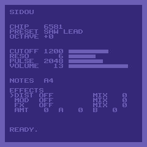

- **Rows 2-3:** SIDOU at 2× in yellow, the version small on the right (row 2).
- **Rows 5-8:** the chip (with two chips both, **KEYS** in yellow on the keys'), the preset, the
  octave: small, the names grey and the values white.
- **Rows 10-17, the four parameters of the sound**, two rows each: the name small, **the number at
  2×** (the cutoff register 0..2047, the resonance, the pulse width, the volume), and a bar in
  the knob's colour (K1 yellow, K2 cyan, K3 light green; the volume white).
- **Row 19:** the notes held. **Rows 21-26:** the effect slots (`>` in yellow at the one EDIT +
  K1..K4 acts on), their algorithms and Mix, and the selected slot's Amount, A and B.
  **Row 27:** READY.
- **The ring** of full blocks in dark grey (light blue on blue in C64).

A held note changes the notes row only (`status_notes`: the view compares what it shows with
the last compose, and when only the notes differ draws that row), so a note costs a row, not
the screen's 900 cells: a note costs 3.1k instructions above idle where it cost 29.6k (the
bound is 30k, which a whole compose with the larger text would have passed). Idle it composes
nothing (7.47k a frame, as before: the bound is 7.5k).

**ABOUT** is unchanged. Its credits are generated pages that fade in and out through colours a
row at a time, and the first page's heading (`SIDOU V<version>`, up to 20 characters) does not fit
at 2× (15 characters a row): the larger text would also double what each fade step sends over
the 163-cell budget the screen is held to.

## SCENE

SCENE (`app/scene_view.h`, the menu's item after STATUS) is M1e's prototype of M2's visuals:
the browser prototype's five generative pieces (`app/scene.h`), ported to the cell grid, each
reacting to the voices, and since M2f a sixth, RED MOON RITE (below), drawn in pixels. SELECT
steps between them; the new one wipes in and a toast names it.
What moves each one is in [controls](../reference/controls.md#scene); in short, a voice's
note-ons trigger its part (a flame's flare, a ripple, a generation, lit stars, an ant's walk),
its envelope (ENV3, from LIVE's tap, which runs while SCENE shows) keeps it going, its pitch
sets a height or a place, a silent voice's part stops, and the cutoff and resonance set the
mood (heat, speed, twist, darker colours). Randomness is a seeded xorshift, so the same music
gives the same frames: the fm1-emu goldens (`tests/golden/lcd/scene-*.png`) are each piece a
second into a held chord.

**FIRE's look.** In silence a low flame still burns (FIRE_IDLE_HOT), so the screen is never dark. The flame's ramp is black, red, light red, a thin band of yellow (lime on this
palette) and white; brown is only the ember bed's glow, and orange (olive-brown here) is not
used: with it the fire read as dirt. The cutoff moves where the white starts (heat 196 open,
beyond any heat shut, on a curve that rises fast, so the presets' cutoffs already burn yellow and
white at the bed), not the heat itself, so the flames keep their shape. The fuel sways along the
bed (two sines drifting apart), a cell drifts a column only one time in four, and one cell in
eight cools by three times more, so the flames break into tongues instead of a mound.

**The canvas.** Each piece draws into a 30 x 30 canvas of its own (1,800 bytes); the view
copies it onto the grid. So a piece that changes a few cells a step (the ant, RULE 30) draws
only those, and SCENE's compose still draws every cell (`app/screen.h`). The pieces share their
state in a union, about 1 KB; SCENE's RAM was 2,784 bytes in all, and RED MOON RITE shares
that memory with them (below).

**The budget.** The copy sends at most 200 cells a frame (`SCENE_VIEW_FRAME_CELLS`, about 17.5 ms
of SPI with their windows): changed cells from where the last frame stopped, until the frame has
spent what the screen's toast, raster and cover leave; a frame that changes more spreads over the
next ones, so a changed cell waits at most about 900 / (the cells left to the copy) frames. What
a toast or the raster drew over is put back the same way; what a toast that shows or MIDI
learn's frame covers this frame (`screen_covered`) is left alone, and learn's frame counts what
it sends (`screen_cover`): LIVE does the same. Only under a wipe are rows copied whole (the wipe
holds the ones it has not reached). On top of that, the two pieces that
change most of the screen in the prototype are trimmed to fit, so the cap rarely bites:

| Piece | Prototype (cells a frame) | On the FM-1 |
|---|---|---|
| FIRE | 426 (the whole screen) | the bottom 14 rows, three 10-column flames; it burns every other frame (two steps at once, so the flames rise at the prototype's speed) and draws half its rows a frame, the even ones then the odd ones: 12.5 fps, at most 210 cells a frame. Heat at or below 48 goes out above the ember bed; a silent voice's fuel falls to FIRE_IDLE_HOT (120), not to 0, so silence keeps a low red flame flickering (about 94 at the bed, a cell row or two high, now and then a tongue to eight rows) |
| PLASMA | 500 | the whole screen, every other row a frame; its top speed is 0.8 rad a second (the prototype's 3.7 changed more cells than the budget has), an eighth of it in silence; a note-on's ripple is one ring growing half a cell a frame, not a train of rings, and voice 3's warmth follows its envelope at most 4 steps a frame |
| RULE 30 | 20 | as the prototype: a 60 x 60 ring of generations in quadrant glyphs, at most 3 generations a frame |
| STARS | 25 | 90 stars, a glyph each, drawn far to near |
| ANT | 3 | as the prototype |

Measured in fm1-emu (`scene_stays_within_its_budgets`, 150 frames a piece of a band on the keys:
an arpeggio note every 4 frames, a bass note every 8, the filter wide open):

| SCENE | Cells a frame (average, most) | SPI a frame (average, worst) | Main loop a frame (average, busiest `ui_poll`) |
|---|---|---|---|
| FIRE | 125.0, 159 | 10.93 ms, 13.85 ms | 101.6k, 58.9k instructions |
| PLASMA | 138.4, 200 | 12.29 ms, 17.64 ms | 141.4k, 53.0k |
| RULE 30 | 18.9, 76 | 1.65 ms, 6.60 ms | 32.7k, 21.3k |
| STARS | 39.5, 68 | 3.59 ms, 6.16 ms | 74.1k, 21.1k |
| ANT | 2.7, 9 | 0.25 ms, 0.80 ms | 29.3k, 18.9k |

The piece steps half way between frames (`views_prepare`), as LIVE reads its tap, so a frame's
`ui_poll` is the copy alone; the busiest `ui_poll` (FIRE's two burns, 58.9k) is half the latency
gate's poll allowance (120k). A piece picked (SELECT, or the menu's ALGORITHM) starts in the
compose of the wipe's first frame, not in the input's call (`ui_encoder`), which the main loop
runs in the same pass as a frame between two drains of MIDI; PLASMA's start, 48.8k when it drew
the whole canvas in the input, draws the 4 rows the wipe reveals each frame. The input now costs
at most 203 instructions and the busiest pass after it (from `midi_drain` to `midi_service`)
60.7k, 61k together against the 120k allowance
(`starting_a_piece_holds_the_main_loop_within_the_poll_allowance`). MIDI learn's frame over
SCENE or LIVE stays within 200 cells a frame: it sent 222 over PLASMA and 286 (24.8 ms of SPI)
over LIVE before the views left its cells out of their budget (now at most 200 and 191).
PLASMA costs 3.4M instructions a second (1.4 % of the core at 240 MHz). A chord's note-ons show
within two frames, and once it has died away every piece calms
(`a_note_moves_every_piece_and_silence_calms_it`, cells in 25 frames):

| Piece | Silence before | A chord held | Silence after |
|---|---|---|---|
| FIRE | 0 | 1,580 | 0 |
| PLASMA | 274 | 2,728 | 207 |
| RULE 30 | 0 | 233 | 0 |
| STARS | 205 | 998 | 112 |
| ANT | 0 | 60 | 0 |

The tap adds to the audio interrupt what it adds for LIVE (4.8 instructions a sample), and only
while SCENE shows. The firmware grew 7.5 KB (the pieces' code, the plasma's distance and sine
tables, 1.2 KB).

## Pixel scenes

A drawn vignette (RED MOON RITE, below) is too many colours a cell for glyphs and too big
for a frame buffer (240 x 240 at 4 bits is 28.8 KB of RAM), so it is **composited a tile at a
time, on demand** (`app/scene_px.h`):

- **The grid's painter region.** Besides a bitmap in flash, the grid's pixel region can take
  its pixels from a painter (`grid_region_painter`): a function the renderer calls for each
  cell of the region as it sends it, filling its 8 x 8 colours; glyphs and overlays still draw
  over them. The grid sends only the cells marked (`grid_mark`), so the painter's owner says
  what changed.
- **Layers.** The compositor holds a stack of up to 24 layers in slots, bottom first: fills,
  gradients (a sky computed on the device), images (`scene_image`, placed by their frame's
  top-left, mirrored or not, with an optional 16-colour remap, clipped to a rectangle), marks
  (single pixels: a spark's rays, an arc, small discs), text in the 8 x 8 font, and calls (a
  function that paints a row span: colour cycling over a mask). Each layer knows its box, so a
  tile draws only the layers over it: RED MOON RITE's frames stack 9 to 11 layers and a tile
  visits 2.2 to 2.3 of them on average.
- **What changed.** Setting a slot to a layer that differs from what it held (any field: a
  layer whose drawing changes while its fields do not changes `param`) makes candidates of
  the tiles under its old and new boxes. The scan composites each candidate into an 8 x 8
  scratch, hashes it (FNV-1a, 32 bits: 3,600 bytes for the screen) and marks it only if the
  hash differs from the panel's. The hash is taken again as the grid sends the tile, so it is
  always what the panel shows; a candidate the grid is about to send anyway is dropped
  without compositing. A tile is therefore composited twice when it changes (once to find
  that it did, once to send it) and once when a layer over it changed without changing it.
- **The invariant.** A run is counted as shown, and its tiles' hashes taken, when it is
  rendered, so every rendered run must reach the panel, or the grid be invalidated. A view
  that has the screen back without setting its painter region again (which sends every cell)
  calls `scene_px_init` or `grid_invalidate` first.
- **The refresh sweep.** `scene_px_refresh` marks the next tiles round the screen whatever
  their hashes say: a tile or two a frame sends the whole screen again every 18 to 36 s, a
  safety net for a change the candidates missed (a forgotten `param`), at no RAM cost (a
  position) and about 4.4k instructions and 0.19 ms of SPI a frame for two tiles.
- **Runs, slices and the budget.** `grid_render_run` composites a run's tiles as it renders
  it, and `ui_poll` renders up to two runs a call, so a run takes at most
  `SCENE_PX_RUN_CELLS` (4) of the painter's cells (`grid_region_painter`'s cap). The scan
  takes `SCENE_PX_SCAN_SLICE` (8) candidates a call at most, in passes of the main loop that
  render no run. The emulator gate ties both to the 120k poll allowance at compile time, with
  a song's analysis slice (39k) in the same pass: they were 8 and 16 until RED MOON RITE's own
  tiles were measured (5,930 at worst, over the bench's 5,300). The
  view sends at most 200 cells a frame, and the grid goes on from where it stopped, round
  the screen, so a marked tile waits at most one sweep. 200 cells in as many windows (the
  worst the cap can make) take 18.5 ms of SPI, within the 20 ms.

**What it costs on the device**, in fm1-emu (`emu-gate`'s `scene_budget.rs`, a frame like
RED MOON RITE's with 13 slots, `bench/workload_scene.h`; instructions, a lower bound on
cycles):

| | Instructions |
|---|---|
| A tile composited, average / worst | 1,959 / 4,826 |
| A cell sent (the tile, its hash, the panel's pixels), average / worst | 2,779 / 5,646 |
| A run of 8 cells, worst; two in a ui_poll (Task 3; the cap is 4 since Task 4) | 35.5k; 71k |
| A scan, a candidate (the tile and its hash) | 2,829: 42 tiles a 120k pass |
| A slice of 16 candidates, worst (Task 3; 8 since Task 4) | 51.9k |
| The whole screen sent (the first frame) | 2.49M |
| The fighters step 4 px: 132 candidates, 123 sent | 0.89M |
| The sky's palette changes: 480 candidates, 247 sent | 1.99M |
| The torches tick: 10 candidates, 10 sent | 95k |

As first written a tile cost 4.8k on average and 8.7k at worst, more than half of it finding
a span's run from the start of the row, and a run of 30 painted cells 230k. Three changes
brought it down: the rows' checkpoints (In flash, below), a sprite drawn into the tile a run
at a time instead of a pixel at a time (`scene_image_blend`, with no divide a pixel), and a
tile looking only at the slots in use. A 40 ms frame leaves about 5.2M instructions after
the audio: RED MOON RITE's busiest frames (176 tiles changed in the prototype, perhaps 250
candidates) come to about 1.2M, a quarter of it.

In RAM the compositor is 4,716 bytes on the device (the slots 768 and their boxes 192, the
slots in use 25, the hashes 3,600, a bit a tile for the candidates 113, counters), and the
grid grew 12 bytes (the painter, its context and its cap). The tests (`tests/app/scene_px.rs`)
check tiles against a Rust model of the same layers in random stacks (mirroring,
transparency, order, remaps, clips), the hash against every change (the panel always equals
the composited screen, and exactly the changed tiles are sent), the runs' cap, the sweep
healing a missed change, any interleaving of changes, sliced scans, runs rendered and left
waiting, delayed sends and held rows (400 seeds of 3,000 steps each converge on the screen),
and against frames that `assets/scene/red-moon-rite.js` draws (`tests/golden/scene/`: seven
frames of the arcade's pattern as the layers the compositor stacks, the torches' cycling and
the status bar left out; `--frames` writes them, and `SIDOU_SCENE_UPDATE=1` regenerates them
when Node is installed).

## RED MOON RITE

RED MOON RITE is SCENE's first music-driven vignette for the device (M2f): two barbarians
with broadswords under a blood moon in a torch-lit ruin. The kick is an overhead chop, the
snare a parry with a spark, the hi-hats footwork, the bass decides who presses forward, the
arp flares the torches and the cutoff darkens the sky in three palettes. The bar-4 fill is a
spinning attack that **disarms** the other fighter: his sword spins away and sticks point-down
in the flagstones, and in bar 1 he bends and pulls it free; nobody attacks while he is
unarmed. It is a homage to late-80s fantasy sword-fighting games, not to any one game:
original art in the 16 colours, with no game's name, logo, sprite, pose, arena or HUD.

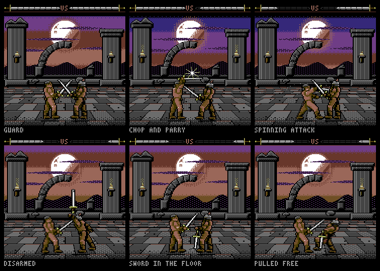

| Asset | What |
|---|---|
| `assets/scene/red-moon-rite.js` | The source: the Scene Arcade's drawing code (`assets/prototypes/sidou-vignettes.html`: the helpers, the painter, the puppet, RED MOON RITE), verbatim but for the changes its header lists, plus the new drawing below. `node assets/scene/red-moon-rite.js` writes the PNGs. |
| `sky-0.png` .. `sky-2.png` | The three sky palettes with the moon, wisps and hills: the screen's rows 16-139, 240 x 124. |
| `arena.png` | The temple and floor, 240 x 240 in screen coordinates, transparent where the sky shows. |
| `barb-0-<pose>.png`, `barb-1-<pose>.png` | The two fighters (0: bare-headed, dark hair, red headband; 1: steel helmet, red plume) in the eight poses (guard, guard2, raise, chop, block, spinA, spinB, hit): 64 x 124, stored at half width (each stored pixel is two on the screen, `gx = 2`); fighter 1 is drawn mirrored. Hip at (58, 72) of the screen-width sprite; the header gives the placement. |
| `barb-0-<pose>-unarmed.png`, `barb-1-<pose>-unarmed.png` | Each fighter without his sword: guard, guard2, hit, and reach (bending to pull it from the floor). |
| `sword-0.png` .. `sword-7.png` | The sword in flight, eight rotations of 45 degrees, each painted whole (no rotated pixels), grip at the centre of 84 x 84 screen pixels. |
| `sword-stuck.png` | The sword point-down in a flagstone, leaning a little, a crack round its point. |
| `flame-mask.png` | The torches' flame area, where the colour cycling draws. |
| `hud.png`, `hud-blade-empty.png`, `hud-blade-full.png`, `hud-blade-tip.png` | The status bar (black, VS, the red line) and side 0's blade meter as the device stacks it: empty, full (drawn clipped to the stamina) and the tip; side 1 is drawn mirrored (M2f Task 4). |
| `red-moon-rite-motion.txt` | The motion the script computes once for the device: each fighter's sword flight and where it sticks, the spark's three stages (M2f Task 4). |
| `red-moon-rite-preview.png` | Six frames of the vignette playing the arcade's pattern (above). |

All PNGs are indexed: the art palette's 16 colours in order, and index 16 transparent where a
PNG has transparency. A test (`scene_rmr_drawing`, in sidou-tests' app tests) runs the script
twice when Node is installed and fails if the runs differ or the PNGs fall behind it.

**The disarm** replaces the prototype's helmet knock (the helmet flew off fighter 1's head and
he fought bare-headed until bar 1). At the spinning attack's last beat, the other fighter's sword
leaves his hand in the `hit` pose; its middle follows a parabola for 20 frames (0.8 s)
and turns a whole number of times, so it lands point-down with its grip where his hand will
be in `reach`. The fighters hold their ground while it is out of his hand. On the first beat
after it sticks he takes `reach` for 8 frames, then has it back in `guard`: with the arcade's
pattern it lands near bar 1's second beat and is back in his hand by its fourth. The fill's
spinner is whoever leads and he disarms the other, so either fighter can be disarmed (both
have unarmed poses); with the arcade's pattern the leader is always fighter 0, so the preview
shows fighter 1 disarmed.

**The status bar** shows each fighter's stamina as a broadsword: the hilt at the screen's
edge, the blade pointing in toward `VS` in eight notches, each stamina lost taking the notch
at the tip (the tip moves in), what is lost left as a dark ghost of the blade. The prototype's
eight square pips a side were replaced after the review below.

### In flash

`host/crates/sidou-tests/src/scene_art.rs` converts the PNGs into `app/scene_rmr_art.c`
(`SIDOU_SCENE_UPDATE=1` regenerates it; a test fails while it is stale), a `scene_image`
(`app/scene_art.h`) each, decoded a row span at a time by `scene_image_row`, or drawn over a
tile a run at a time by `scene_image_blend`:

- **Run-length rows with transparency.** Each image is cropped to the rectangle its pixels
  cover inside its frame; each row uses the logos' [row format](bitmap-codec.md), with one
  colour that no image of the set uses (cyan) coding transparency. Row packets share byte
  substrings within a pool. A sprite
  keeps its frame's size, its anchor (a fighter's feet at (58, 112) of the 128 x 124 screen
  frame; a sword's grip) and `gx`; drawn mirrored, a row is read from its end and the anchor is
  (frame width - 58, 112), so no mirrored copies are stored.
- **Checkpoints.** Runs are split at each pool's interval (at most 32 stored pixels).
  Checkpoints live in the row packets, so repeated rows share the checkpoints too. A span
  starts at its preceding checkpoint rather than walking the whole prefix.
- **Patches.** An unarmed pose is coded as the rectangle where it differs from its armed pose
  (the arm and the sword), over that pose, when that is smaller. The byte-run selection model
  measures guard, guard2 and hit at 120 to 188 bytes each instead of 813 to 931, before dictionary
  packing; reach has no armed pose and is whole.
- **The skies** are a gradient computed on the device (`scene_gradient_row`: the prototype's
  stops and 6-row Bayer seams) and an overlay of the pixels it does not give (the moon, wisps
  and hills): the byte-run selection model measures **7,472 bytes for the three, against
  11,284 coded whole** (rows shared across
  the three, checkpoint tables aside). The gradient costs a fill a pixel on its flat rows and
  a Bayer compare a pixel on its seam rows (24 of its 124): measured in fm1-emu, 230
  instructions a tile averaged over the screen (about 430 on each of the 480 tiles it
  covers), so it was chosen.
- **The arena** is one image of the whole screen, transparent where the sky shows.

Original byte-run measurements, before the status and motion tables:

| What | Bytes |
|---|---|
| Fighters, 16 armed poses (781 of checkpoints) | 17,718 |
| Unarmed poses (6 patches, 2 whole reaches) | 2,461 |
| Swords, 8 in flight and stuck | 1,878 |
| Skies (3 overlays) and the arena (3,934 of checkpoints) | 21,880 |
| Together, rows shared: 30,741 of runs, 9,955 of row offsets and checkpoints, 1,098 of tables | **41,794** (40.8 KB of the 48 KB ceiling) |

The kinds are each image's runs and offsets alone; sharing rows across images brings the sum
down to the total. A test prints the total and fails over 48 KB (`the_art_fits_its_flash_ceiling`),
and another decodes every image, mirrored too and from any pixel, back to its PNG pixel for
pixel. Since M2f Task 4 the set also holds the status bar (`hud.png` and the blade meter
empty, full and its tip, 4 images) and the motion tables (below). That complete byte-run set
was **43,413 bytes**. With the shared row format it is **41,694 bytes**: 34,538 coded data,
5,338 row offsets and 1,818 of image/gradient/motion metadata, all below the unchanged 48 KB ceiling.

### On the device

`app/scene_rmr.h` is the prototype's logic in C: its `step` (once a row of the music) and its
layers' and stages' state (once a frame), with the disarm, integer only. A host test plays it
against the script frame for frame (`tests/golden/scene/rmr-trace.tsv`, 768 frames of the
arcade's pattern, written with `--frames`: positions, poses, timers, stamina, the sword's path
and where it sticks, the sky's rows; all equal), and another stacks its layers for the
script's golden frames (`tests/golden/scene/rmr-*.png`): equal pixel for pixel but the spin's
arc (the device's sine, `app/sine.h`, within a pixel of the script's) and the torches and the
status bar, which those frames leave out. What the script computes once is in
`assets/scene/red-moon-rite-motion.txt`, which it writes beside the PNGs and the converter
compiles: each fighter's sword flight (19 grips and rotations from his place, then where it
sticks) and the spark's three stages (pixels around the blades' meeting point).

**The music** (`app/scene_song.h`): the song control's row, note and gate events, which the
main loop drains once a pass and hands to each listener (`platform/fm1/main.c`), and chip A's
cutoff as the player wrote it; with no song, the instrument. The voices' roles and drums come
from the song's `SCNE` chunk (`docs/reference/song-format.md`) or are guessed (a noise-first
wavetable is the drums, by its first step's pitch; the lowest other voice the bass; the rest
the arp); the place in the bar is the pattern's row modulo 4 beats of the `MIDI` chunk's rows
a beat (4); muted voices play no part ([controls](../reference/controls.md#red-moon-rite)).

**The layers**, bottom first (21 slots of 24): the status bar, each meter (empty, full clipped
to the stamina, the tip), the sky (one call: each cell row its palette's gradient and overlay,
so the wipe touches 30 tiles a frame), the arena, the two torches (a call each: six colours
cycling up a wobbling flame, sparks over it when flared), the stuck sword behind the fighters,
each fighter's shadow and sprite (mirrored for fighter 1, an unarmed patch over the armed pose),
the spark (a call over the stage's rows), the arc (14 marks), the stuck sword over the hand
that pulls it free, the flying sword, and the cover: over what the screen draws on the scene
this frame (the toast's row, MIDI learn's frame, the raster's border) each cell that is not
blank shows its own background under its glyph. The step is in SCENE's compose, so a frame's
cells go out together after it; the scan then runs a slice of 8 candidates in each `ui_poll`
that has nothing to send, until the frame has spent its 200 cells. Silence calms it: a second
after the last gate the torches and the arc hold still, the refresh sweep stops, and nothing is
sent.

**What it costs**, measured in fm1-emu over 60 s of the demo song
(`red_moon_rite_stays_within_its_budgets_over_a_minute_of_the_song`, `emu-gate` screen.rs;
instructions; rebased onto main `084fea9`):

| RED MOON RITE | Measured | Bound |
|---|---|---|
| Tiles (cells) sent a frame, average / most (the prototype: 117 / 176) | 98.931 / 170 | 109 / 180 |
| SPI a frame, average / worst | 8.727 ms / 14.954 ms | 20 ms |
| Main loop a frame (ui_poll) | 908.6k (17 % of a frame's 5.2M) | 1.0M |
| Busiest ui_poll / main-loop pass | 57,353 / 57,754 | 62k / 63k, each with a song's 39k slice within 120k |
| Busiest scan slice (8 candidates) / run (4 cells) | 56.3k / 24.6k | 62k / 27k |
| Costliest tile / a tile on average | 5,930 / 2,892 | 6,500 |
| The keys' band (scene_stays_within_its_budgets) | 120.5 cells a frame, 1.03M | 133, 1.14M |
| Its start (SELECT, or the menu into it) | 58.7k the busiest pass | 65k |

The pair drifting a pixel a frame is most of it: both fighters' and shadows' tiles change.
The audio is the host's sample for sample while it shows
(`the_first_song_is_bit_exact_while_red_moon_rite_plays_it`, emu-gate song.rs). The LCD goldens
`scene-rmr-song`, `scene-rmr-disarm` and `scene-rmr-stuck` are the demo song a second in, the
fill's landing and the sword in the floor; `scene-rmr` the keys' chord, as for the other pieces.

**In RAM** RED MOON RITE shares the PETSCII pieces' memory (a union in `scene_view`): the
compositor (4,724 bytes) and the vignette's state (136) take the place of a piece and its
canvas (about 2.7 KB); the music hooks (`scene_song`, about 240 bytes) are always there. SCENE
grew 2,318 bytes, 5,112 in all. **In flash**, the art 43,413 bytes and the code about 6.6 KB
(`scene_rmr.c` and `scene_song.c` at -Os, the view's part, the event fan-out), with the
compositor's and decoders' 3.9 KB (M2f Tasks 2-3) that the linker kept out until now: the
image grew 54,416 bytes against main `084fea9`: 479,584 bytes in all, below M2f's 512,000-byte
ceiling. The free-RAM gate measures 15,756 bytes (RAM region 10,060, POOL 5,696), against this base's
9,000-byte gate (22,000 less M2d's 6,000, M2a's 2,000 and M2f's 5,000). The linked RAM use
grew 2,336 bytes against that base, including alignment and the music hooks' data.
Excluding the 4-byte alignment gap before `.bss`, the free region tails total 15,752 bytes.
RAMTEXT is unchanged at 44,404 bytes of 49,152. The code came to about 10.5 KB including
the compositor and decoders, against the 10 KB budget; optional wisp parallax is not done.

### The originality review

The preview and the sprite sheets were set beside a gameplay still of the genre's best-known
C64 game (a one-on-one barbarian duel, 1987), looked at outside the repository and described
here in words only, and checked point by point:

| Point | That game | RED MOON RITE | Verdict |
|---|---|---|---|
| Fighters' builds and costume | Two small, thin hi-res figures, bare-chested in loincloths, the same figure for both players | Two bulky shaded multicolour figures (64 x 124 pixels, `gx = 2`) of SIDOU's painter: one bare-headed with dark hair and a red headband, one in a round steel helmet with a red plume, grey or red loincloths, leather bracers and boots | Different; the nearest point is the genre's archetype both share (bare chest, loincloth, broadsword). Fighter 0's red headband is the detail to watch |
| Poses | Its own animation set | Joint angles of SIDOU's puppet (guard, raise, chop, block, spin, hit, reach), not traced from any game | No pose matched |
| Arena | An enclosed stone hall: a wall with two arched windows and spectators in them, grey flagstones, pillars wrapped in snakes with skulls at the screen's sides; a forest glade elsewhere; a goblin who drags the loser off | An open ruin at night: a raster sky in three palettes, a blood moon, wisps and hills, a broken arch, a broken and a whole plain column with torches, steps, flagstones in perspective; no spectators, no snakes, no skulls, no goblin | Different; both have stone floors and a column toward each edge, plain here |
| HUD | A large title banner at the top centre with the scores under it; each fighter's energy as six red circles in the top corners | Prototype: eight square pips a side from the corners inward, the first two red, then yellow, `VS` between | **Too close** (a row of red markers per fighter in the top corners): replaced by the blade meter, which has no title, no score, no circles, and steel instead of red |
| Finishing moment | A decapitation, and the goblin | A disarm: the sword spins away and sticks in the floor; no head or helmet comes off, no blood, nobody is hurt while unarmed | Different |
| Names and lettering | Its title logo | No logo or title in the piece; `VS` in the 3 x 5 font; no game's name anywhere | Clean |

**Sign-off: signed off by the user on 2026-10-16,** as it is: the fighters, the ruin, the
blade-meter HUD and the disarm. The two readings above were accepted with it: the sword is
back during bar 1 (not before it), and with the arcade's pattern only fighter 1 is disarmed.
For any song (M2f Task 4) the fill's leader disarms the other fighter, whichever he is.

## Title cards

A major view entered from the menu opens behind a **title card** (`app/title_card.h`), after
the logo page's chapter cards: THE and the view's name in Metal Chrome's lettering on a
dithered purple and red glow with stars, a rule under the title and a glint on its last
letter. There is no "CHAPTER" line. **THE SCENE** comes before SCENE, **THE CHIP** before the
CHIP view and, with CARDS at ALWAYS only, **THE OSCILLATOR** before LIVE when HOME goes back to
it from the menu (not at power-on: the boot's title card is enough). The held frames are `assets/logo/title-oscillator.png`,
`title-scene.png` and `title-chip.png`, drawn by `assets/logo/metal-chrome.js` (`titleCard`,
the page's `chapterCard` adapted to the cell grid) with the glow alone in `title-glow.png`:

| THE OSCILLATOR | THE SCENE | THE CHIP |
|---|---|---|
| 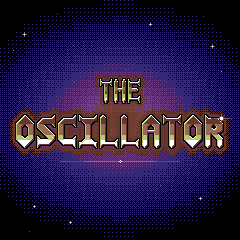 | 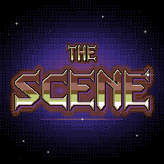 | 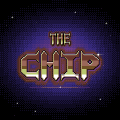 |

**The sequence** (25 fps):

1. **The glow fades in** through four ordered-dither levels. The glow is drawn a cell at a time
   with the font's dither glyphs D0..D15 (the 4 x 4 Bayer order the art dithers with) in two
   neighbouring stops of black, blue, purple and red, from a table of each cell's level
   (0..47, 16 to a stop; a quarter of the screen, as the glow is symmetric about its centre).
   Level k of 4 is the table's level times k / 4, so the fade costs no flash. Each level holds
   2 frames once all its cells are out: 25 frames in all (1.0 s), the first level spread over
   5 frames as it changes all 900 cells of the menu under it.
2. **The title wipes in** from the left, 3 columns a frame (10 frames, 0.4 s): the card's
   bitmap in the grid's pixel region, grown over the same bitmap cells, so a frame sends the
   90 cells it adds at most.
3. **It holds** 25 frames (1 s), sending nothing.
4. **The view cuts in** under it in bands (5 frames, 0.2 s; it starts there, SCENE's piece
   in the cut's first frame).

About 2.6 s from the input to the view.

**What ends it.** Any button or encoder ends it at the next frame and does nothing else (its
capture takes every event); a note from the keys or MIDI plays as ever and ends it (the
instrument's note-on count, so however short the note; a note held from before does not).
The audio, the keys and MIDI run as always; nothing holds them up. No toast or raster draws
over it, and what changed meanwhile is not toasted after it.

**The option.** CARDS in the menu (after OCTAVE) is OFF, ONCE or ALWAYS (ALGORITHM steps it,
clamped at the ends), stored with the settings. ONCE, the default, plays THE CHIP and THE
SCENE the first time each since power-on and never THE OSCILLATOR; ALWAYS plays all three every
time. Where no card plays, SCENE, CHIP and LIVE wipe in as the other views do (LIVE, back from
the menu, with a wipe up from the bottom).

**The bitmaps.** A card's bitmap holds its pixels only in the cells that differ from the glow
(the letters, their halos, the rule, the glint, the stars: 251 cells for THE OSCILLATOR, 331
for THE SCENE, 261 for THE CHIP, a bit each in `title_card_cells`), where the firmware puts a
blank glyph so the bitmap shows alone; in the others it holds the glow's background stop flat,
under the dither glyph the firmware draws there. So the bitmaps compress well. The converter
(`host/crates/sidou-tests/src/title_card.rs`) reads the glow's levels from `title-glow.png`
(refusing a cell that is not a dither glyph of two neighbouring stops, or a glow that is not
symmetric), finds each card's cells and writes `app/title_card_bitmap.c` (SIDOU_LOGO_UPDATE=1
regenerates it, and a drift test fails while it is stale). In flash, the three cards are
**27,087 bytes**: 25,062 of runs shared by the cards, 1,440 of row offsets, 360 of cell bits and
225 of glow levels (27,128 in the firmware's `.rodata`, with their tables), and 0.7 KB of code;
drawn into each bitmap, the glow's dither would make them 57,190. Most of it is the letters'
dithered halos, runs of one or two pixels.

**The budget.** A frame sends at most 200 cells (`TITLE_CARD_FRAME_CELLS`, about 17.5 ms of SPI
with their windows): a step that changes more goes out in bands from where the last frame
stopped. Measured in fm1-emu (`title_cards_stay_within_their_budgets`, from the input to the
end of the cut, nothing played):

| Card | Frames | Cells a frame (average, most) | Worst SPI | Main loop a frame (average, busiest `ui_poll`) | Input | Busiest pass |
|---|---|---|---|---|---|---|
| THE SCENE | 66 | 72.4, 200 | 17.14 ms | 56.0k, 71.6k instructions | 350 (`ui_encoder`) | 73.1k |
| THE OSCILLATOR | 64 | 68.7, 200 | 17.14 ms | 55.1k, 71.3k | 387 (`ui_buttons`) | 72.8k |
| THE CHIP | 66 | 72.4, 200 | 17.14 ms | 55.6k, 71.2k | 364 (`ui_encoder`) | 72.9k |

The busiest frames are the glow's first level: 200 cells, and the scan of the 900 cells for
those that differ. The input and the busiest main-loop pass (`midi_drain` to `midi_service`)
together are 73.4k, within the latency gate's 120k poll allowance (a compile-time tie and a
measured check, as for SCENE). The held frames are checked against their PNGs pixel for
pixel on the host and in fm1-emu (all three, also against the goldens
`tests/golden/lcd/title-chip.png`, `title-scene.png` and `title-oscillator.png`).

## Help card

HOME held 600 ms opens a **help card** over the view that shows (`app/help_view.h`; the keys
are in [controls](../reference/controls.md#help)). It is drawn in the menu's style at 2x,
14 characters across, in the theme's roles, never a colour of its own:

- **Rows 0-2:** the title bar in `title_fg` on `title_bg`: `HELP` from column 1 and the card's
  name (`LIVE`, `MENU`, `CHIP`, `TRACKER`, `SCENE`, `ALL`) right-aligned.
- **Rows 4-27:** up to eight lines, one every three rows (two of text, one blank): the control
  on the left in `hot`, what it does right-aligned in `value`, on the screen's own background;
  the rows a card does not use stay blank.
- It is drawn in **units** (the title bar with the row under it, then each line, the last with
  the rows under it) that go out whole, as many a frame as fit 190 cells: six frames, and no
  frame over 200 cells whatever it covers (a view's pixel region or overlays included). Nothing
  draws over it (no toast, raster or popup); once drawn it sends nothing.
- It ends on any button or encoder (its capture takes the event and does nothing else), and the
  view under it cuts back in in bands, as after a title card. A note plays and does not end it.
