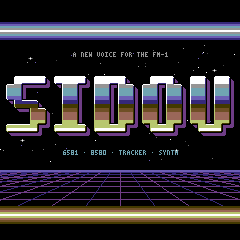

<!-- SPDX-FileCopyrightText: 2026 SIDOU contributors -->
<!-- SPDX-License-Identifier: GPL-3.0-or-later -->
# SIDOU art direction

This page fixes the palette, font, layout grid, motion rules and logo before
screens multiply (design document, section 7 "Look and feel"). Every screen
and piece follows it. The visual reference is the browser prototype
(<https://claude.ai/artifact/Ghyhf6bUkXUFrawXbsc3X5>), which runs the same
grid, palette and font.

The look: an 80s home computer, C64 culture in spirit. Art is original only:
no Commodore marks, logos or trade dress, and no characters, sprites or names
from existing games.

## Palette

Sixteen colours, the C64's, after Philip "Pepto" Timmermann's measurements of
the VIC-II. The firmware's table is `grid_palette` in `app/grid.c` (plain
RGB565). `ui_init` in `platform/fm1/ui.c` byte-swaps it once (`LCD_SWAP`), so
pixels the SPI sends from memory reach the panel high byte first.

| Index | Name (`GRID_…`) | sRGB | RGB565 |
|---|---|---|---|
| 0 | `BLACK` | `#000000` | `0x0000` |
| 1 | `WHITE` | `#FFFFFF` | `0xFFFF` |
| 2 | `RED` | `#68372B` | `0x69A5` |
| 3 | `CYAN` | `#70A4B2` | `0x7536` |
| 4 | `PURPLE` | `#6F3D86` | `0x69F0` |
| 5 | `GREEN` | `#588D43` | `0x5C68` |
| 6 | `BLUE` | `#352879` | `0x314F` |
| 7 | `YELLOW` | `#B8C76F` | `0xBE2D` |
| 8 | `ORANGE` | `#6F4F25` | `0x6A64` |
| 9 | `BROWN` | `#433900` | `0x41C0` |
| 10 | `LIGHT_RED` | `#9A6759` | `0x9B2B` |
| 11 | `DARK_GREY` | `#444444` | `0x4228` |
| 12 | `GREY` | `#6C6C6C` | `0x6B6D` |
| 13 | `LIGHT_GREEN` | `#9AD284` | `0x9E90` |
| 14 | `LIGHT_BLUE` | `#6C5EB5` | `0x6AF6` |
| 15 | `LIGHT_GREY` | `#959595` | `0x94B2` |

RGB565 keeps the top 5, 6 and 5 bits of red, green and blue.

Default use:
- **Screen:** light blue text on blue, inside a light blue border (the
  READY. screen).
- **Voices, by waveform:** pulse cyan, saw yellow, triangle light green,
  noise light grey.
- **Raster ramp** (logo stripes, raster bars): white, yellow, light green,
  cyan, light blue, purple, light red.
- **Warnings and errors:** light red; **OK:** light green.

## Layout grid

The 240×240 LCD is a grid of **30×30 cells of 8×8 pixels**, the same medium
as the C64's 40×25 PETSCII screen. Column 0 is the left edge and row 0 the
top; a cell is at pixel (8 × column, 8 × row).

- Each cell holds a font code and a colour byte: foreground in the low
  nibble, background in the high nibble (`GRID_ATTR(fg, bg)`).
- **Frames** take the outer ring (rows 0 and 29, columns 0 and 29). Content
  starts at column 2, leaving a one-cell margin inside the frame.
- **Title** on row 2; a status or toast line on row 26 or 27.
- Text is upper case. Lower case codes show as upper case.
- Pixel art beyond the font (oscilloscopes, the logo) is drawn as **pixel
  overlays** on cells: an 8×8 one-colour mask over the cell's glyph
  (`grid_overlay`, at most `GRID_OVERLAYS` = 255 cells at once, enough for
  LIVE's three scopes of about 80 cells each; the pool costs 2.5 KB of RAM).
  A view switch clears them all.

## Font

`assets/font/sidou-8x8.txt` is the source: one glyph per entry, 8 rows of
`#` and `.`, in a text format described at the top of the file.
`host/crates/sidou-tests` generates `app/font.c` (a `const` table of 256
glyphs, 2 KiB in flash) and `app/font.h` (`FONT_<NAME>` codes) from it; a test
fails when they fall behind the sheet. To change a glyph, edit the sheet and
run, from `host/`:

```sh
SIDOU_FONT_UPDATE=1 cargo test --release -p sidou-tests --test app font
```

The sheet draws 163 glyphs (lower case reuses upper case). The face is
chamfered capitals with 2-pixel stems, 7×7 pixels in the top-left of the
cell, so text keeps a one-pixel gap to the right and below.
Graphics glyphs fill the whole cell, so they join up. The firmware's glyph
sheet (the CHARSET view in `app/views.c`, opened from the menu) shows them
all, with the palette; its fm1-emu snapshot is
`tests/golden/lcd/charset.png`.

| Codes | Glyphs |
|---|---|
| `0x20`–`0x7E` | ASCII; `a`–`z` reuse `A`–`Z` |
| `0x7F` | `FULL` block (also the cursor) |
| `0x80`–`0x8F` | quadrants `Q0`–`Q15`; bit 0 top left, 1 top right, 2 bottom left, 3 bottom right |
| `0x90`–`0x98` | lower eighths `V0`–`V8`, filled from the bottom |
| `0x99`–`0xA1` | left eighths `H0`–`H8`, filled from the left |
| `0xA2`–`0xAA` | bar eighths `BAR0`–`BAR8`: left eighths on rows 1–6, for meters |
| `0xAB`–`0xBB` | ordered-dither levels `D0`–`D16` (4×4 Bayer, 4 × n pixels set) |
| `0xBC`–`0xCA` | frames: `BOX_H`, `BOX_V`, square and `ROUND_` corners, tees, `CROSS` |
| `0xCB`–`0xD8` | icons: dots, star, ball, pip, arrows, play, note, square |
| `0xD9`–`0xDB` | `SLOT_L`, `SLOT_R`, `SLOT_LR`: the logo's slotted raster bands, a top half's quadrants 3 rows deep |
| `0xDC` | `SCOPE_MID`: LIVE's dotted scope centre line, a pixel every 4 on the top row |
| `0x00`–`0x1F`, `0xDD`–`0xFF` | blank, free for later glyphs |

**Provenance and licence.** The font is drawn for SIDOU. Its letters and
digits came from the browser prototype, and the rest of ASCII, the bar
eighths, tees and side arrows were drawn for the sheet in the same style.
The first version of the sheet was too close to `font8x8_basic`, the
public-domain placeholder of M1a: 14 printable glyphs were bit-identical to it
(`# $ & ( ) + . 1 > N W [ ] ^`) and 36 within 4 pixels by the measure below.
Every one of them that could differ was redrawn:
`! " # $ & ( ) + - / 0 1 4 < > @ K M N W [ \ ] ^ { }`.
The Commodore character ROM was not copied either: the face only takes the
C64's spirit (chunky capitals on an 8×8 cell).

`glyphs_are_not_copied_from_font8x8` in
`host/crates/sidou-tests/tests/app/font.rs` keeps it that way. It compares
each printable glyph with `font8x8_basic` (kept as test data in
`host/crates/sidou-tests/tests/data/`, never built into the firmware). The
distance is the number of differing pixels, the smallest over shifts of up
to one pixel in each direction. Every glyph must be at least 5 pixels away;
the median is 7. The exceptions are glyphs whose shape is forced at 8×8 with
2-pixel strokes. Any 8×8 font draws them nearly alike:

| Glyph | Distance | Why it stays close |
|---|---|---|
| `.` | 0 | A 2×2 dot on the baseline. |
| `,` | 0 | That dot with a one-step tail down to the left. |
| `'` | 0 | The comma's shape, raised to the cap line. |
| `_` | 0 | One full-width line on the bottom text row. |
| `` ` `` | 1 | A three-row tick down to the right. |
| `\|` | 2 | A 2-pixel vertical line; font8x8's is broken in the middle. |
| `:` | 4 | Two 2×2 dots. |
| `;` | 4 | The colon with the comma's tail. |
| `I` | 4 | A 2-pixel stem between full-width bars; the 4 pixels are font8x8's narrower bars. |
| `T` | 4 | A 2-pixel stem under a bar; the 4 pixels are font8x8's serifs. |

Licence: **GPL-3.0-or-later**, like the rest of SIDOU's own files, so the
font ships with the firmware under the same terms.

## Motion rules

- **25 fps:** the UI composes a frame every 40 ms (`UI_PERIOD_MS`).
- **Only changed cells go out.** The renderer (`app/grid.h`) keeps the frame
  the panel shows next to the one being composed. Changed cells are sent in
  runs: horizontally adjacent changed cells on a row form one LCD window.
- **SPI budget: at most about 20 ms of SPI per 40 ms frame at steady state.**
  At the LCD's 12 MHz SPI a cell is 128 bytes, 85 µs; a window adds 11
  command bytes (7 µs) and the CPU's command turnaround. 20 ms is about
  230 cells per frame. A full screen is 115,200 bytes, 77 ms.
- **CPU:** composing the status screen and the empty main-loop passes between
  frames cost about 37k instructions a frame, and rendering about 580
  instructions a cell, so a full screen is 2.2 ms of CPU at 240 MHz (fm1-emu,
  `host/crates/emu-gate/tests/screen.rs`).
- **Pieces over budget** drop their frame rate, shrink their area or use a
  coarser palette. A transition may spend a full redraw once, not every
  frame.
- **The main loop never waits on the LCD.** One run goes out per pass while
  the panel is free, rendered while the last one transfers. Nothing in the
  UI touches the audio interrupt or its budget.
- Each screen gets fm1-emu LCD snapshot tests; each animated piece gets a
  busiest-frame cost test (main-loop instructions and SPI bytes).

## Views, menus and transitions

The screen is a stack of **views** (`app/screen.h`): each is a table of
enter, exit, input and compose functions, and the one on top has the focus.
It composes every cell each frame and gets the panel's events first; what it
does not take plays the instrument (`app/views.h`,
[controls](../reference/controls.md)).

- **Frames:** PETSCII box glyphs with the title set into the top edge,
  between spaces (`widget_frame`). A screen keeps the full-block border on
  the outer ring.
- **Menus:** a list of items, each a label and a value right-aligned against
  the frame (an arrow for an item that opens a view). The cursor is a
  **blinking block** in front of the selected item, 8 frames on and 8 off
  (320 ms each). SELECT moves it, ALGORITHM changes the value.
- **Toast:** a line of reverse-video text (blue on light blue) on row 27 for
  1.5 s, saying what changed.
- **Wipe:** a view opens top first and closes bottom first, 4 rows a frame
  behind a white edge row, so the full redraw a view switch needs spreads
  over 8 frames (about 320 ms). The rows not reached yet keep the old view
  on the panel.
- **Raster:** colour bands in the raster ramp's order run down the border,
  one row every other frame, then the border gets its own colour back. A chip
  change runs it once round the ramp (7 steps, 14 frames). It waits while a
  wipe runs.

Measured in fm1-emu (`screen_changes_and_transitions_stay_within_the_budgets`):

| Change | Frames | Windows | SPI bytes | Worst frame |
|---|---|---|---|---|
| Wipe up from the status screen to the menu | 8 | 52 | 78,908 | 11.6 ms |
| Wipe down from the menu to the status screen | 8 | 48 | 77,200 | 10.4 ms |
| Raster and toast (chip change) | 15, every other one | 451 | 123,105 | 10.5 ms |
| Menu idle (the cursor) | 1 in 8 | 1 | 139 | 0.1 ms |

The animated screens compose every frame (`the_boot_and_about_stay_within_their_budgets`,
260 frames of the full boot and 1920 of About, a full round of its 16 pages), with Cracktro
Chrome:

| Screen | Cells a frame (average, most) | Windows a frame | SPI a frame (average, worst) | Main loop a frame (average, busiest `ui_poll`) |
|---|---|---|---|---|
| Full boot | 24, 150 | 8.1 | 2.1 ms, 12.8 ms | 37k, 33k instructions |
| About | 87, 163 | 15.9 | 7.5 ms, 14.0 ms | 118k, 72k instructions |

About costs 3.0M instructions a second (1.2 % of the core at 240 MHz). With Pulse Train
(M1e Task 4) it was 94 cells a frame (148 at most, 12.8 ms), 144k and 91k, and the boot
46k and 37k: the logo was animated, and Cracktro Chrome is still. A run's pixels are
written two at a 32-bit store, a cell row from two 4-entry tables (the glyph's colours, and
the overlay over the background for a blank glyph row): About was 161k and 105k, the boot
50k and 64k, with a pixel a store. A bitmap's run fills two pixels a store as well.

A wipe sends only the rows that differ, once each, and its edge row once
more; a raster step recolours the 116 border cells in 58 windows. Every frame
stays inside the 20 ms budget.

A wipe is sized for a view that holds still: the rows it has revealed must not change
under it. The animated views (About, the boot's title card) hold their animation while a
wipe or a raster runs (`screen_animating`), so a wipe into them sends its 150 cells a frame
at most, 12.8 ms. Revealing Cracktro Chrome's bitmap costs the main loop no more than cells:
the wipe into the title card (its whole scene, 4 rows a frame) 134k instructions a frame and
30k in its busiest `ui_poll`, into About 118k and 65k. Before, About's bars, logo and
scroller moving in the revealed rows made
a frame of the wipe into it 243 cells, 21.0 ms, and the title card's stripes 192 cells,
16.6 ms (`every_wipe_into_an_animated_view_sends_only_its_rows` in fm1-emu, and
`the_wipe_into_about_sends_only_its_rows` and `the_wipe_into_the_title_card_sends_only_its_rows`
on the host, at every phase).

## Logo

**Cracktro Chrome, chosen by the user**, is SIDOU's logo: chunky bevelled SIDOU letters in
raster bands (white, light grey, cyan, light blue and blue over brown, orange, light red and
yellow), a black outline and a 4-pixel purple extruded shadow, in a frozen demo-scene intro:
stars, a cold and a warm raster bar and a perspective grid floor, on black, in the 16
colours only. It is original art made for SIDOU, drawn pixel by pixel in code.



| Asset | What |
|---|---|
| `assets/logo/cracktro-chrome.js` | The source: the logo page's drawing code (variant V2), verbatim. `node assets/logo/cracktro-chrome.js` writes the PNGs below; they match Chromium's canvas drawing the page pixel for pixel. |
| `assets/logo/cracktro-chrome.png` | The scene, 240 x 240, 4 bits a pixel in the art palette's order: what the firmware shows. |
| `assets/logo/cracktro-chrome-lettering.png`, `-lettering-2x.png` | The lettering and its shadow alone, 229 x 61, on transparency (palette index 16); the 2x, by nearest neighbour, heads the project README. |
| `docs/art/avatar.png` | The avatar, 48 x 48: the S on stars over two bars. |
| `app/logo_bitmap.c` | The scene as a `grid_bitmap`, generated (below). |

The logo is a **pluggable asset** (`app/logo.h`): the boot's title card and About draw
whichever logo `logo_default` names, through a table in flash:

| Field | Cracktro Chrome (default) | Pulse Train |
|---|---|---|
| `cols`, `rows`: the footprint in cells | 30 x 8 (240 x 64 pixels, the scene's lettering band) | 15 x 5 (120 x 40 pixels) |
| `overlays`: overlay cells at most | 0 | 55 |
| `cells_per_frame`: the most cells one frame changes | 0 (still) | 42 |
| `draw(grid, col, row, frame, bg)` | the band in the pixel region | frame `frame` of the animation (25 fps, 0 the still) |
| `scene(grid, frame)`: the title card's full screen | the whole scene in the pixel region | none (NULL) |

`draw` paints every cell of the footprint, glyph, colours, overlay and pixel region (it clears
an overlay it does not need), so a view composes it like the rest of its screen. The declared
cost and overlays are measured (`host/crates/sidou-tests/tests/app/logo.rs`), so a test fails
when a logo's drawing and its table disagree. `overlays` and `cells_per_frame` are 16-bit,
room for a logo up to the whole screen (900 cells).

Where it goes, and a test checks each logo fits (`each_logo_fits_each_consumers_slot`):
- **The title card** shows the logo's scene when it has one, with the version on row 1 and
  PRESS ANY KEY on row 28, both rows black in the scene (`BOOT_SCENE_VERSION_ROW`,
  `BOOT_SCENE_KEY_ROW`). A logo without a scene gets the old card: a slot 5 rows from row 8,
  between two ramp lines (`BOOT_LOGO_ROW`, `BOOT_LOGO_ROWS`), the name and the version below.
- **About** gives it 8 rows from row 0 (`ABOUT_LOGO_ROW`, `ABOUT_LOGO_ROWS`), centred:
  Cracktro Chrome's lettering band whole, Pulse Train on rows 1-5.

The emulator checks both against `assets/logo/cracktro-chrome.png` pixel for pixel: the
title card everywhere but its two text rows, and About's band against the scene's pixel
rows 72-135.

**The lettering band** is the scene's cell rows 9-16 (`LOGO_CHROME_BAND_ROW`): the lettering
takes pixel rows 76-135 (75 is its black outline, on black) and columns 5-233, and nothing
of the scene's text or floor reaches into the band; its stars come with it.

**Pulse Train**, the alternative (built), on the grid: the letters are a 5 x 7 face at 4x, so
each letter pixel is a cell quadrant. Their 28 pixel rows are seven bands of 3 rows and a
slot, coloured through the raster ramp. A cell row holds two bands: the top one as a `SLOT_*`
glyph in its colour, the bottom one as an overlay in the next band's. The pulse wave (2 pixels
thick, cyan) is an overlay on the two rows below. The stripes roll one band every 4 frames
(frames 2, 6, ...), the wave moves 4 pixels and its duty cycle sweeps every 4 frames (frames
0, 4, ...), and odd frames change nothing. `logo_default = &logo_pulse_train` brings it back
everywhere. Its letter cells use all three colours a cell holds, so raster bars cannot pass
behind them: tried with the letter cells taking the bar's colour as their background, the
bar's lower half took its upper half's colour in every letter cell, the letters' bottom bands
and the cyan wave vanished into bars of the same ramp colours, and About sent 110 cells a
frame instead of 95 (14.3 ms at worst).

The other concepts from the prototype, drawn in code on the cell grid, were Three Voices
(triangle, saw and pulse traces weaving through the letters), READY. (the name typed at the
prompt in quadrant blocks) and 28 Pin (SIDOU on a 28-pin chip whose pins light with the
gates). The logo page also has the **metal variants**, explorations only: Metal Chrome
(blade-cut letters with horn serifs on a dithered glow), Blood Chrome (the same in cold steel
with a red underglow) and Metal Emblem (a chrome shield with horns, bolts and the spiked
lettering), and **chapter cards** in the Metal Chrome lettering, full-screen title cards for
switching into views such as SCENE or performance mode.

### Logo bitmaps

A cell holds three colours at most (background, glyph, overlay), so a pixel-art logo in the
16 colours cannot be drawn with glyphs. It is supplied like the font and drawn through the
renderer's pixel region.

- **Source:** an indexed PNG in `assets/logo/`, at most 240 x 240 and in whole 8 x 8 cells,
  whose pixels are art palette colours exactly (its palette in any order); anything else is
  an error.
- **Conversion:** `host/crates/sidou-tests/src/logo.rs` (as `src/font.rs` is for the font)
  writes `app/logo_bitmap.c`, a `grid_bitmap` (`app/grid.h`): each pixel row run-length coded,
  a byte a run of 1..16 pixels (`(length - 1) << 4 | colour`), with a table of where each
  row's runs start so any row decodes on its own; rows alike share their runs. A test fails
  when the file falls behind the PNG (`SIDOU_LOGO_UPDATE=1` rewrites it, as
  `SIDOU_FONT_UPDATE` and `SIDOU_CREDITS_UPDATE` do), and others check the round trip and
  that the compiled table decodes to the PNG pixel for pixel.
- **Size:** the whole scene is **4,526 bytes** of flash: 4,046 of runs and 480 of row
  offsets, 15.7 % of its 28,800 bytes at 4 bits a pixel (6,739 without sharing rows; the
  black rows and the 2-pixel bars repeat). The firmware image grew 6.2 KB in all. So the
  whole scene goes on the device, and About takes its band from the same bitmap.
- **Drawing:** `grid_region(g, col, row, w, h, bitmap, bx, by)` makes w x h cells take their
  background, pixel for pixel, from the bitmap's cells from (bx, by). Their glyphs'
  foreground and their overlays still draw over it, so text and overlays work on a picture
  (the title card's version and PRESS ANY KEY); a blank glyph shows the bitmap alone.
  `grid_render_run` decodes the run's part of each of its 8 pixel rows straight into the
  panel's pixels, two a store, then draws the glyph and overlay pixels of the cells that have
  any. One region at a time: setting it marks the cells it leaves and covers to be sent, the
  same region again sends nothing, and a logo drawn in cells or a view switch clears it.

What works, and what does not, on this panel and budget:

- **A still logo, or a full-screen splash, works.** It goes out once, under a wipe (4 rows a
  frame, 12.8 ms of SPI at most), and costs nothing after that; the decoder runs only for the
  cells being sent. A full 240 x 240 repaint in one frame would be about 77 ms.
- **A 240 x 240 logo needs a title layout of its own.** The title card is the scene, with
  only two lines of text on rows the scene leaves black, and About takes the lettering band.
- **Palette cycling is not free.** The panel takes RGB565 pixels, not indexes into a palette
  it keeps: changing a colour means resending every cell that shows it. Rolling Cracktro
  Chrome's raster bands through the lettering would resend its 207 lettering cells in 22
  windows, 26.7 KB or 17.8 ms of SPI a step, on top of About's own frame (up to 163 cells):
  over the 20 ms budget. The stripes stay still; a roll would need a frame of its own every
  few frames, with About's other motion paused for it.
- **Small logos** of up to three colours a cell (a mono or two-tone mark) need no region:
  overlays carry them, one cell each, as Pulse Train's bands do.

## Boot

The boot sequence (`app/boot.h`) is a view over the status screen at power-on, after the
prototype's `Boot`:

| From | Shows |
|---|---|
| 0 s | `*** SIDOU V<version> ***`, the chip and voices, `READY.` and the cursor |
| 0.8 s | `LOAD"SIDOU",8,1` typed, 70 ms a character |
| 2.2 s | `SEARCHING FOR SIDOU` |
| 3.0 s | `LOADING`, and raster stripes in the border, new every other frame |
| 5.6 s | `READY.`, then `RUN` typed from 6.2 s |
| 7.0 s | the title card: the logo's scene (Cracktro Chrome's), the version and licence above it, `PRESS ANY KEY` blinking below |
| 10.0 s | the status screen wipes in |

The stripes split each border cell row in two colours at a random height (a lower-eighths
glyph): the 116 border cells, about 10 ms of SPI, every other frame. Every other change goes
out within the budget; the first frame is drawn whole before the display is on.

- **Short by default:** the title card alone, 1.2 s, then the status screen. Without storage
  the firmware cannot tell the first boot after an install from the others, so it does not
  pretend to. **HOME held while powering on** plays the full sequence: once the interrupts
  are on, `platform/fm1/main.c` waits `FM1_DEB_PRESS + 1` key scan frames (3.3 ms; the audio
  already runs) and reads HOME's debounced level. The key scan also makes one press edge for
  a key held at power-on; the boot takes that first HOME press as part of the hold. Without
  HOME held, a HOME press skips like any other button, from the first frame on. With M2's
  storage the full sequence will play once after an install (a flag in flash), and short
  after that ([TODO](../TODO.md)).
- **Skippable by anything:** a button or an encoder ends it at the next frame and does nothing
  else (the boot's capture takes it: no octave step, no chip toggle); a note from the keys or
  MIDI ends it and plays, even one shorter than a frame (`live`'s note-on count tells).
  What MIDI changes meanwhile (the chip, the octave) shows no toast or raster over it.
- **It holds nothing up:** the audio interrupt, the tick (the key scan, MIDI) and the
  interrupts start before the screen's first frame, and the main loop sends that frame like
  any other, without waiting on the panel (a full screen, about 80 ms of SPI on the device);
  the display comes on once it is out. The keys and MIDI play from the start: in fm1-emu the
  audio starts 394 ms after power-on, after `lcd_init`'s 350 ms of reset and wake-up delays
  (`the_audio_and_the_keys_start_before_the_display`). Before, the first frame went out
  whole, blocking, before the audio started.

## About

ABOUT, the menu's last item (`app/about.h`), is the prototype's cracktro trimmed to the SPI
budget, on black, laid out around Cracktro Chrome's lettering band: the logo at the top
(rows 0-7), a ramp line, the credits over a starfield (heading on row 10, lines from row 12),
another ramp line, and two raster bars sweeping behind a sine scroller (rows 21-29). The bars
are the scene's cold and warm ones (blue, light blue, cyan; brown, orange, light red), with
no white, and the scroller is white, so its letters read over every band. HOME goes back.

- **Credits** come from `CREDITS.md`: `host/crates/sidou-tests/src/credits.rs` generates
  `app/credits.c` (a page per section, more when it runs over 8 lines, wrapped at 26
  characters with names kept whole, accents dropped for the font). A credit longer than a
  page starts a page and goes on under `<SECTION> (CONT.)`, cut between who and what; no
  other credit shares a page with its tail, so no sentence runs into the next credit. A test fails when it falls behind the file;
  `SIDOU_CREDITS_UPDATE=1` rewrites it. A page shows 4.8 s; a first page names SIDOU, its
  version and licence.
- **The trim**, from the prototype's 240 cells a frame to 87: the logo is still, sent once
  under the wipe; the bars are 5 bands of 4 pixels (two a cell, with a lower-half glyph) and
  move one band at a time, one bar on each odd frame; the credits' rows cascade in and out 4
  frames apart,
  fading through 4 colours a level every other frame, so at most two text rows change in a
  frame; the scroller's letters are overlays shifted 2 pixels a frame, each bobbing a whole cell
  row on a sine two screens long; the stars are one-pixel overlays in three layers moving a
  pixel every 4, 2 or 1 frames, on blank cells only. Measured above (Motion rules).

**Naming:** the instrument is **SIDOU**, always in capitals, in the font or
the logo's own letters. "SID" refers to the chip only when describing what
SIDOU emulates.

## LIVE

LIVE (`app/live_view.h`) is the root view, what the screen shows from power-on, after the
prototype's: a header line in reverse video (chip, preset, octave); each voice in a box
(rows 1-6, 7-12, 13-18) with its oscilloscope, 160 x 32 pixels, its envelope as two columns
of lower eighths (ENV3, 32 levels), and its note, waveform, pulse width and envelope stage;
FILTER, the response of the mode at the cutoff and resonance in 16 columns of lower eighths
(30 Hz..12 kHz, -36..+12 dB, the cutoff's column yellow, recomputed only when they change,
from the core's fitted filter tables); VU, each voice's level and the output's left and
right peaks after the effect slots, 6 dB a cell; and the three effect slots with their
algorithm and Mix. The status screen moves to the menu (STATUS). M2's STEP view will be the
default then.

**The tap.** The audio interrupt renders a block in chunks of 16 samples and after each
writes a point into a ring of 256 (`app/scope.h`): each voice's waveform output (its top 8
bits) and its oscillator's phase (the accumulator's top 8 bits). Once a block it copies each
voice's ENV3, envelope state and sustain level, and raises the left and right peaks with
every 8th frame of the output. Rendering in chunks gives the samples one call gives, so the
audio is unchanged (the device's output matches the host's sample for sample with LIVE
showing). It runs only while LIVE shows: on top, or under MIDI learn's frame. Single producer, single consumer, lock-free: the
interrupt overwrites the oldest points and publishes its head once a block; the main loop
copies the newest 224 and drops the copy if the interrupt came round to it meanwhile.

| Tap | Measured (fm1-emu, `the_live_view_tap_costs_the_audio_interrupt_little`) |
|---|---|
| Points | 2,757 a second (a frame: 110; a read: 224, 81 ms) |
| Audio interrupt | +4.8 instructions a sample (368.15 against 363.33, a chord held, LIVE against the menu), bounded at 6 |
| Code in `.ram_text` | 32,472 of 49,152 bytes (+308: `scope_render`, `scope_peaks` and their calls) |
| RAM | the ring and envelopes 1,560 bytes; LIVE's state 6,152 (its traces and their columns, the points it reads, its canvas) |

**The scopes are folded by phase** (an equivalent-time display): each point lands in the
column its oscillator's phase belongs to, two to four periods across (more for higher
notes), a column showing the mean of its points and the empty ones a line between their
neighbours. A held note's trace stands still at any pitch, and 110 points a frame draw it
whole where a time base would need 20 times as many. A hard-synced voice is folded by its
sync source's phase, so the sync shape shows. The height is the waveform times the envelope:
flat at rest. A trace that moved by a pixel at most stays as drawn (the fold's wobble), so a
held chord sends about 5 cells a frame.

**The budget.** Each trace is an overlay per cell it crosses (at most 240 of the pool's 255).
Three voices of noise change about 240 cells a frame, 20.5 ms of SPI: over the budget. LIVE
holds itself to 200 cells a frame (`LIVE_VIEW_FRAME_CELLS`, about 17.5 ms with the windows):
the scopes get what the rest of the frame and the screen's toast and raster leave
(`screen_layer_cells`), and a trace that does not fit keeps its last look and goes first next
frame, so the voices take turns. The canvas (everything but the scopes) is composed off the
grid, built whole once and then a part at a time: the header, a voice's box, FILTER, VU and
the slots are drawn again only when what they show changes, an envelope bar or a meter only
its own cells, and a toast's frames put back only the toast's row. Going back to the menu
leaves the traces flat and the envelopes and meters empty, so LIVE comes back at rest rather
than showing what it showed when it went. The tap is
read half way between frames (`views_prepare`), so no main-loop pass is long enough to hold
up MIDI (the M1d latency gate). While a wipe or a raster runs LIVE holds still, redrawing the
overlays a view switch cleared one voice a frame, ahead of the wipe.

Measured in fm1-emu (`live_stays_within_its_budgets`):

| LIVE | Cells a frame (average, most) | Windows a frame | SPI a frame (average, worst) | Main loop a frame (average, busiest `ui_poll`) |
|---|---|---|---|---|
| At rest | 0, 0 | 0 | 0, 0 | 13.7k, 4.2k instructions |
| A chord of saws, from the note-ons (75 frames) | 4.5, 160 | 1.8 | 0.4 ms, 13.9 ms | 47.5k, 59.1k |
| Three voices of noise (75 frames) | 146, 161 | 23.7 | 12.6 ms, 14.0 ms | 141k, 60.5k |

The noise case costs 3.5M instructions a second (1.5 % of the core at 240 MHz). Where a
frame of it goes (each function with its callees): rendering the 146 cells 33k, finding
the runs 16k, LIVE's compose 52k (setting the scope cells' overlays 27k of it), reading and
folding the tap half way between frames 30k. Before the canvas was drawn a part at a time
and the pixels two at a store it was 206k (the compose 84k, the rendering 64k), and the
busiest `ui_poll` 89k. The plan's 70-90k a frame holds for a held chord, not for noise;
the busiest `ui_poll` is half the latency gate's poll allowance (0.5 ms, 120k instructions,
which `screen.rs` holds every view's worst to). With the TRS jack at full speed (a note-on
and its note-off every 1.92 ms, `midi.rs`), LIVE's frames cost 84k (115k before) and the
main loop runs 5.7M instructions a second, 2.4 % of the core. The status screen, idle,
still composes nothing: 7.4k a frame (7.3k before LIVE).
