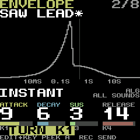

<!-- SPDX-FileCopyrightText: 2026 SIDOU contributors -->
<!-- SPDX-License-Identifier: GPL-3.0-or-later -->
# SIDOU as a DAW plugin: spike

**Status:** spike done, 2026-11-05. Nothing in `rel160` or `main` changed. The roadmap item
("SIDOU as a DAW plugin: a SIDOU edition of fm1-emu's FM-1 plugin", `docs/ROADMAP.md`, Later and
ideas) now needs a design session. The FM-1 was never touched: no flash, no SysEx, no MIDI port
opened. The plugin takes MIDI only from its host, and the probe below passes MIDI in memory.

## Short answers

- **SIDOU runs unchanged in fm1-emu's plugin engine.** It boots, plays notes, and its LAB page
  and knobs work from the plugin side.
- **CPU:** one instance runs at **17.6x real time** on one core of an M1 Max, so it costs about
  **6 % of one core** at real time. Eight instances side by side keep 16-17x each. 32
  instances on the 10 cores still run at 4.2x each. The CPU is not what limits a SIDOU edition.
- **Latency:** the plugin reports `host block + 1024` frames, for example **34 ms at 48 kHz with
  a 512-sample block** (26 ms at 128). The firmware adds **7.3 ms** (321 frames) from a note's
  stamp to its sound. The host compensates what is reported when it plays back. Played live, the
  total is felt.
- **The prototype works:** LAB's K1-K4 are automatable plugin parameters that send the CC/NRPN
  for the LAB page the firmware is on, and a side panel reads LAB's page, the sound's name, its
  ADSR, cutoff and resonance from the firmware's RAM. In the probe run, K1-K4 moved the sound's
  ADSR from 0/9/10/6 to 9/6/3/14, read back from RAM and shown on SIDOU's own screen.
- **Recommendation: go, as a design session first.** Build the edition as a thin layer over
  fm1-emu's plugin, and get the two hooks it needs into fm1-emu upstream instead of keeping a
  fork. That is a memory watch and a firmware-described parameter set.

## What was built

The fm1-emu patch and the headless host are kept in `spikes/daw-plugin/` (the owner, 2026-11-04):
`fm1-emu-sidou-edition.patch` applies to fm1-emu `9de1ef0` cloned into `build/ext/fm1-emu`, and
`probe/` builds against that clone. The outputs below were in `build/ext/` and went with the
spike's worktree; `probe render` makes them again. The LAB screen is kept in `docs/media/`.

| Piece | Where | What |
|---|---|---|
| fm1-emu at `v0.4.0` (`9de1ef0`) | `build/ext/fm1-emu` | `tools/build_plugin.sh` with `NO_INSTALL=1`: CLAP 7.9 MB, VST3 8.6 MB, AU 8.2 MB, nothing installed |
| The SIDOU edition patch | branch `sidou-edition` in that clone, saved as `build/ext/sidou-edition.patch` (82 lines changed in fm1-emu and the new `crates/fm1-plugin/src/sidou.rs`) | the engine takes `Cmd::Watch(regions)` and copies them into `View::peek` with the screen every 30 ms; four parameters, LAB K1-K4, send the current page's target (`sidou::target`, a table from `docs/reference/midi.md`); the FX page follows the selected slot; the editor gets a right-hand side panel (the state lines and K1-K4 sliders); 4 unit tests |
| A headless host | `build/ext/sidou-edition-probe` (GPL-3.0-or-later) | `state` writes the RAM map (`sidou-state.json`) from SIDOU's ELF symbols (`instrument`, `ui`) and `sidou_sys::ilp32`'s offsets; `render` boots the package in the plugin's engine, plays, presses ENV, turns K1-K4, and saves a WAV and screen PNGs; `instances N` measures N engines at once |
| The package | `build/ext/pkg/sidou.fwsc` (SHA-256 `2cdf5eb3…`) and `sidou_app.elf`, copied from the rel160 build of 2026-11-04 | |

The plugin finds the RAM map through the `SIDOU_STATE` environment variable. Without it, it is
fm1-emu's plugin plus four knobs that do nothing.

### The probe run

`sidou-edition-probe render` covers 9.5 s of audio. It boots, plays C4 E4 G4 C5 at 3-5 s,
presses ENV at 5.5 s (LAB opens at ENVELOPE, `lab_page` 0 to 1 in RAM), and sets K1-K4 to
0.6/0.4/0.2/0.9 at 6.0 s. That sends CC 73/75/79/72, and ATTACK, DECAY, SUS and RELEASE in RAM go
from 0/9/10/6 to 9/6/3/14. Then it plays C4 and G4 with the new envelope.

- WAV: `build/ext/out/sidou-plugin-spike.wav` (44.1 kHz stereo, 9.5 s; peak about -23 dBFS at
  MASTER's default).
- Screens: `build/ext/out/sidou-boot.png`, `sidou-lab-envelope.png`,
  `sidou-lab-envelope-knobs.png`. The last one is kept as
  [docs/media/plugin-spike-lab-envelope.png](../media/plugin-spike-lab-envelope.png): LAB's
  ENVELOPE page showing 9, 6, 3, 14, and `*` for an edited sound.

## Measurements

Apple M1 Max (8 performance cores and 2 efficiency cores), release builds, the emulated clock at
240 MHz (the plugin's default), JIT on. Another agent's jobs were running: the load average was
about 5 during the runs, and 45-67 earlier.

| Run | Result |
|---|---|
| fm1-emu's own engine test with `FM1_TEST_FW=sidou` (load about 60) | boots, 57,600 lit pixels, "could run 7.5x real time" |
| Probe render, boot to 3 s | 0.24 s wall time |
| Probe render, 9.5 s of audio | 0.62 s, 15.3x real time including the boot |
| 1 instance, held chord, 10 s | 17.6x |
| 2 / 4 / 6 / 8 instances | slowest 17.5 / 17.4 / 17.3 / 16.1x |
| 16 / 32 instances, 5 s | slowest 7.7 / 4.2x |
| Note stamp to sound (firmware and engine) | 321 frames, 7.3 ms |
| Reported latency (`lead = ceil(block x 44.1/rate) + 1024`) | 48 kHz/512: 1,627 samples, 33.9 ms; 48 kHz/128: 1,243, 25.9 ms |

**How many fit:** 32 instances run at more than 4x on this Mac, so a project's worth of SIDOUs
fits easily. The limit is the host's threads (one engine thread per instance), not the
emulation. The 1,024-frame margin dominates the latency. At 17x, a smaller margin is probably
safe for SIDOU, but that is fm1-emu's setting.

**Not measured:** the plugin inside a real DAW, and its GUI. Loading it in a host would mean
installing it in `~/Library/Audio/Plug-Ins`, which the spike did not do. Apple's `auval` and
Steinberg's validator were not run on the patched build, and there is no screenshot of the side
panel. The probe drives the same engine and parameter code without the GUI. The patched bundles
build.

## What a SIDOU edition would take

| Piece | Size | Notes |
|---|---|---|
| Large screen mirror | S | The panel already draws the LCD. This adds a second, scalable view (2x-4x, crisp pixels). |
| LIVE's knobs as parameters | S | Every LIVE control has a CC. The table follows `docs/reference/midi.md`. |
| LAB's knobs | M | Page-following K1-K4 work (prototype). DAW-correct automation wants **stable parameters per card**, such as "ENV Attack" and "FILTER Cutoff", not knobs whose meaning changes with the page. Both need feedback: read the value back from RAM and set the host's parameter, so a turned panel knob or a preset change moves the plugin's knob. **FILTER ENV and LAYERS have no CC or NRPN**, so they need NRPNs in the firmware (one table row each in its map, with the MIDI doc regenerated). MACRO's K3/K4 too. |
| Tracker entry from the computer keyboard | M | Through the panel's key and encoder events (`Cmd::Key`, `Cmd::Enc`), as fm1-live maps keys today. That needs a keymap for the tracker's gestures (note keys, octave, cursor, EDIT, REC) and a help overlay. No firmware change. |
| Side panels from firmware state | M each, L for the set | The prototype panel is S. A pattern, instrument or table view reads the song region (`song_region`, GT2 layout) and decodes it with SIDOU's own parsers (`sidou-sys`, host build). The hard part is a **stable map**: the package carries no ELF, so the map has to ship beside each `.fwsc`, keyed by the package's SHA-256 and generated by the build like `sidou-state.json`, or the firmware publishes a small descriptor at a fixed address. See the decisions. |
| Scopes | S-M | Chip A and B's voices from the voice shadow, or the output ring. |
| Packaging, signing, CI | M | macOS: an Apple Developer ID and notarization to hand it to others, since ad hoc signing only works on the building Mac. A Windows build exists upstream. A CI job builds against a pinned fm1-emu. |
| Upstream hooks in fm1-emu | S-M | `Cmd::Watch` and `View::peek` (7 lines here), and a way for an edition to add parameters, panels and a MIDI mapping without forking `lib.rs` and `editor.rs`. Proposed to the author, not forked long-term. |

The whole edition is **L**, matching the roadmap's M-L. The first useful release (mirror, LIVE
knobs, stable LAB parameters with feedback, one state panel) is **M**.

## Licences

- fm1-emu and its plugin: MIT. nih-plug: ISC (built without its GPL VST3 bindings).
  clap-wrapper and the CLAP SDK: MIT. Apple's AudioUnitSDK: Apache-2.0. Steinberg's VST3 SDK
  3.8+: MIT, according to fm1-emu's `crates/fm1-plugin/README.md`. All of these combine with
  GPL-3.0.
- A SIDOU edition that links SIDOU code (`sidou-sys` for layouts or song parsing) is a combined
  work under **GPL-3.0-or-later**, the way the probe is. fm1-emu's MIT code inside it keeps its
  notice. If it only reads a generated JSON map and embeds no SIDOU code, the plugin can stay MIT,
  and the map is data.
- The firmware it loads is SIDOU's package, GPL-3.0-only as a whole (`LICENSING.md`), and is
  distributed with its source as today. Shipping the edition with SIDOU's `.fwsc` bundled is
  aggregation plus the GPL's source offer. Saving a project embeds the package (base64), as
  fm1-emu's plugin already does for any firmware.

## The Firmware Hub's VIBE FM

[thefirmwarehub.com/convert](https://thefirmwarehub.com/convert/) (read 2026-11-04) builds a
firmware's **own C source** with the VIBE FM SDK into one `.wasm` file that plays as VST3/AU/CLAP
on macOS, Windows and Linux, in the browser, and on VIBE FM hardware. The page says this avoids
emulation ("a few % of one core", no added latency). Only open-source firmwares qualify, each
one is checked by hand, the SDK is in early access, and only OberVave and SLOOP are converted
(plugin 0.7.4, beta). For SIDOU it is **complementary, not a replacement**:

- It needs SIDOU ported to the SDK's platform API, a second platform layer beside `platform/fm1`
  that has to be kept in step and tested.
- Its CPU lead is small for SIDOU, which already costs about 6 % of one core emulated.
- It cannot read the device's own state the way the edition does: an exact image, the same
  songs and flash, panels from RAM.

Its real advantages are latency, Linux and the browser, and a second piece of hardware: a
distribution route worth taking once its SDK is open. The edition is the authoring tool.

## Recommendation

**Go**, in this order: a design session (stable parameters versus page knobs, the state map, the
keymap). Then propose the watch and edition hooks to fm1-emu upstream (into
`docs/upstream-reports.md` first, batch rule). Then the first release (M) as a GPL-3.0-or-later
crate in SIDOU's host workspace on top of a pinned fm1-emu, with the firmware NRPNs for FILTER
ENV and LAYERS proven in emu-gate first.

## Decisions for the owner

1. **Go to the design session?** The spike found no blocker.
2. **Automation model:** stable per-card parameters (recommended; recall-safe), page-following
   K1-K4 (closer to the panel), or both.
3. **The state map:** a JSON generated by the build and shipped beside each `.fwsc` (no firmware
   change), or a descriptor the firmware publishes at a fixed RAM address (works with any
   package, and costs flash and a format to keep stable).
4. **Firmware NRPNs for FILTER ENV, LAYERS and MACRO's K3/K4**, useful for every controller
   anyway. That is a firmware change under the usual budgets.
5. **Upstream or fork:** propose `Cmd::Watch` and an edition hook to fm1-emu (recommended) rather
   than keep a fork. Filed later in a batch.
6. **Licence of the edition:** GPL-3.0-or-later, linking SIDOU's parsers (recommended), or MIT
   reading data only.
7. **An Apple Developer ID** for signing and notarizing a published build (yearly fee), or
   source and ad hoc builds only.
8. **VIBE FM:** ask for SDK access and treat a port as a separate, later item?
9. ~~**Keep the spike code?**~~ Kept in `spikes/daw-plugin/` (the owner, 2026-11-04).
