<!-- SPDX-FileCopyrightText: 2026 SIDOU contributors -->
<!-- SPDX-License-Identifier: GPL-3.0-or-later -->
# Videos

SIDOU's how-to videos are made from the [recipes](recipes/): each recipe runs in fm1-emu, the
ergonomics harness captures every frame of the screen and the sound
([TESTING.md](../TESTING.md), "Reusing captures for the manual and for videos"), and
`tools/make-videos` turns the capture into a video. Every picture and every sound in them is
the firmware's own, played in the emulator; a recipe that stops working fails
`--check-recipes`, so a video cannot show something the firmware no longer does.

The songs the videos play (CHROME COMET, IRON RITE, NEON HIGHWAY, PAPER LANTERNS) go onto a real
FM-1 from the demo's [Songs page](https://dsablic.github.io/sidou/songs.html), over USB.

## The videos

Durations are of the wide cut; each comes as `ID.mp4` (1920 x 1080), `ID-square.mp4`
(1080 x 1080) and `ID-vertical.mp4` (1080 x 1920), with `ID.srt` (the captions, as a sidecar:
nothing is written into the picture but the headline and the label on the control) and chapter
marks.

| Video | Preview | What it teaches | Length (wide, MB) |
|---|---|---|---|
| [sidou-intro](recipes/sidou-intro.json) |  | SIDOU in a minute: GoatTracker 2 songs written on the FM-1, STEP with locks, a song on one SID while you play the other, SPREAD putting the two chips left and right, the chip's character, chord arpeggios, RED MOON RITE | 77.4 s, 8.0 MB |
| [whats-new](recipes/whats-new.json) | 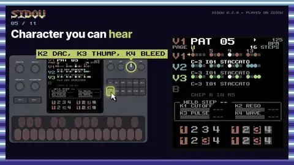 | The release's highlights: a steady MIDI clock, REC over a loop, the tracker pages, STEP, character you can hear, SPREAD, chord arpeggios, the soft limiter, help on HOME, songs over SysEx | 57.8 s, 5.1 MB |
| [first-sound](recipes/first-sound.json) | 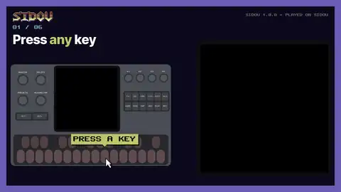 | Switch on and play: a key sounds at once, LIVE, three voices, OCT+ | 21.4 s, 2.1 MB |
| [shape-a-sound](recipes/shape-a-sound.json) | 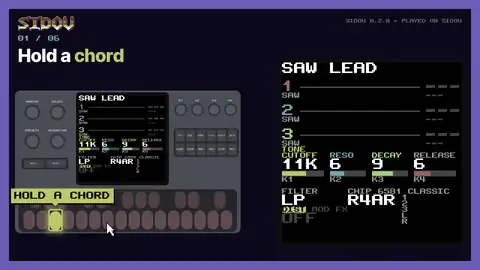 | K1 closes and opens the filter, K2 adds resonance, PRESETS picks another sound | 26.2 s, 2.1 MB |
| [mute-and-solo](recipes/mute-and-solo.json) | 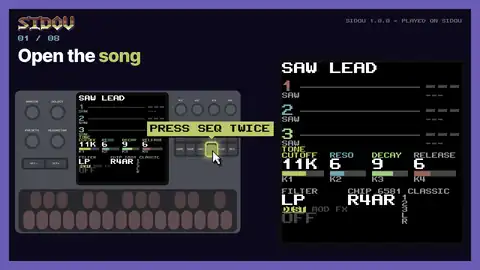 | PLAY the built-in loop, GLO + a key mutes or solos a voice | 27.0 s, 2.8 MB |
| [step-a-beat](recipes/step-a-beat.json) | 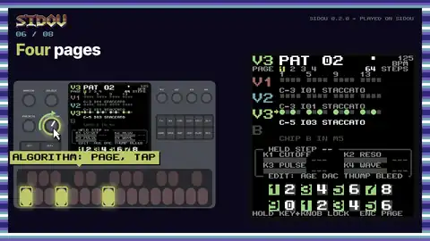 | A new song, a drum lane on STEP, kicks, snares and hats on four pages, PLAY, a cutoff lock | 44.8 s, 3.7 MB |
| [rec-over-loop](recipes/rec-over-loop.json) | 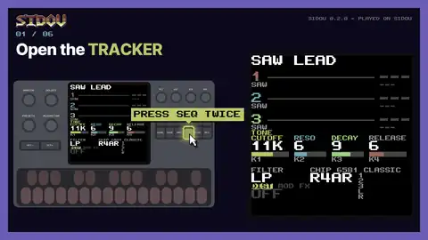 | TRACKER, PLAY, REC and play a melody over SIDOU LOOP in time | 27.8 s, 2.5 MB |
| [save-and-load](recipes/save-and-load.json) | 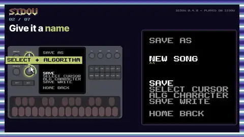 | SAVE AS with a name (BEAT 1), NEW, then LOAD it back | 34.6 s, 2.4 MB |
| [chord-arpeggio](recipes/chord-arpeggio.json) | 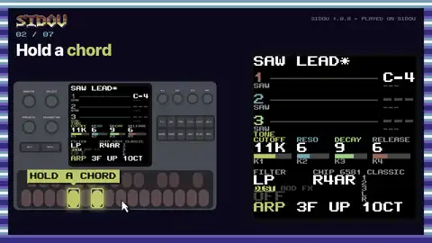 | ARP on LIVE: a held chord as one voice stepping through its notes, ARP + K1, K2 and K3 for rate, order and span | 21.9 s, 2.1 MB |
| [chip-spread](recipes/chip-spread.json) | 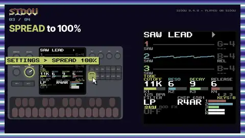 | A song on chip A, the keys on chip B, SETTINGS, SPREAD to 100% and 50%: the two SIDs left and right | 27.8 s, 2.3 MB |
| [chip-character](recipes/chip-character.json) | 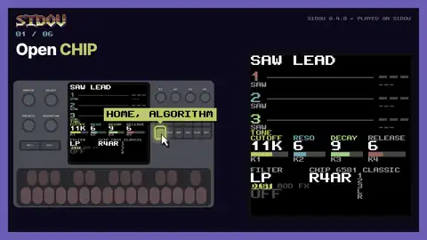 | CHIP: AGE, DAC, THUMP and BLEED, each heard on a riff | 28.5 s, 2.9 MB |
| [add-an-effect](recipes/add-an-effect.json) | 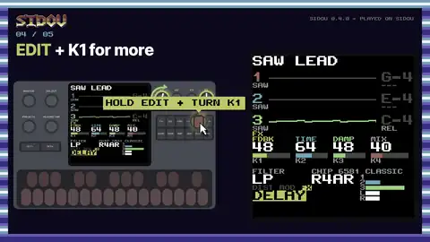 | SCL picks the FX slot, ENV its algorithm (DELAY, REVERB), EDIT + K1/K4 its amount and mix | 19.0 s, 2.1 MB |
| [midi-learn](recipes/midi-learn.json) | 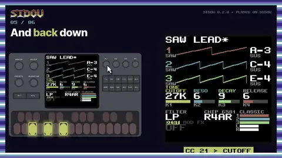 | SAVE + K1 opens MIDI LEARN; a controller's CC 21 then turns the cutoff | 17.6 s, 1.8 MB |
| [track-bass](recipes/track-bass.json) | 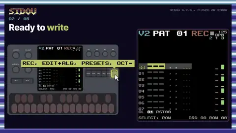 | After the beat: TRACKER, REC with the song stopped, a bassline note by note (Am F C G) | 32.0 s, 2.7 MB |
| [track-lead](recipes/track-lead.json) | 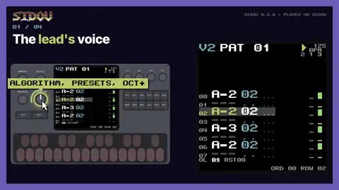 | After the bassline: REC while it plays, a four-bar lead recorded in time | 30.0 s, 2.4 MB |
| [play-over-a-song](recipes/play-over-a-song.json) | 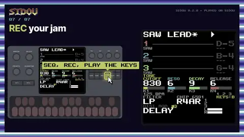 | Load NEON HIGHWAY, play it on chip A, jam on chip B, K1, DELAY, a mute, REC the jam | 46.0 s, 4.0 MB |
| [remix-a-song](recipes/remix-a-song.json) | 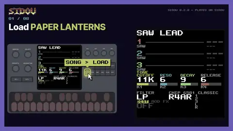 | Load PAPER LANTERNS, change it in STEP, a new instrument, a mute, SAVE AS PAPER LANTERNS 2 | 41.1 s, 3.1 MB |

## What a video is

- **A payoff first**: the last seconds of the result, then a typed `LOAD"…",8,1` title card
  with the loading stripes, under CHROME COMET played by SIDOU (a capture of the
  `soundtrack` journey in `tools/videos/soundtrack.txt`).
- **Each step**: its number, its headline with one word in an accent colour, the FM-1's panel
  with the control in use lit (the rest dimmed, a thick ring and a glow, a press that sinks and
  bursts, a turn's arrow and the knob's pointer turning, a hold's ring filling like a timer), a
  C64 sprite pointer that flies to it a moment before, and a label in plain words beside it
  (`HOLD GLO + KEY 2`). The screen, three times its size, pushes in on the region where the
  result shows once the inputs are done. A raster-bar wipe runs through the border at each
  step, and the screen's frame glows on the song's beat.
- **The end**: the result held, the screen easing back out.
- **The sound**: the capture's own audio, normalised to -16 LUFS (true peak -1.5 dBTP).

The look lives in `tools/videos/template.py` (layouts, colours, fonts, wipes, cards), the
panel's geometry in `tools/videos/panel.py` (after fm1-emu's panel drawing, MIT), what happens
when in `tools/videos/make.py`, and per-video settings (no teaser, the soundtrack under some
steps, the tempo for the beat glow, where the preview is taken) in `tools/videos/videos.json`.
A recipe step's optional `focus` (the control, a screen region, the callout) and `chapter`
steer it ([recipe-schema.md](reference/recipe-schema.md)); without them the step's first input
gives the control and the label.

## Regenerating

```
tools/make-videos                       # every recipe, all three cuts, into build/videos
tools/make-videos --recipe step-a-beat  # one (repeatable)
tools/make-videos --fast                # half resolution, fast x264: a quick look
tools/make-videos --formats wide        # only some cuts
```

It needs the fm1 build (`build/fm1`, or `SIDOU_FM1_BUILD`), Rust, `uv` (Python with Pillow
13.0.0, fetched by uv) and ffmpeg with libx264. The captures are cached under
`build/videos/cache`, keyed by the firmware image, the recipe (and the recipes it starts
after), its songs and the harness's sources: a change of the look re-renders without the
emulator, a change of the firmware or the recipe captures again. The captures run several at
once; each video's frames render on every core and go straight into ffmpeg.
`build/videos/report.json` has each video's length, sizes, render time and frames' digest.

A firmware change that alters the screens (help cards, the menu, STEP's numbering) needs only
this one command; a recipe that no longer runs as written stops it with the failing step
named, like `--check-recipes`.

**Deterministic:** the same firmware, recipes and Pillow give the same frames, byte for byte
(`build/videos/ID.frames.sha256`, one SHA-256 a frame). The MP4 and the normalised WAV came out
byte for byte the same too when rendered twice on the same machine (ffmpeg with `-fflags
+bitexact` and one x264 thread), but another ffmpeg or x264 build may encode the same frames to
other bytes: the frames' digests are the check.

The previews here are the one place generated media is committed: `docs/media/videos/*.webp`
(4 s, 480 x 270, under 300 KB each). The MP4s stay in `build/`.

## Credits for the videos

- **Inter Tight**: the Inter Project Authors (OFL-1.1), the videos' headlines.
- **fm1-emu**: Joakim Eriksson (MIT); its panel drawing gives the videos where each control sits.

These are for the videos only, so they are here rather than in CREDITS.md, whose sections are also
the device's ABOUT pages.
